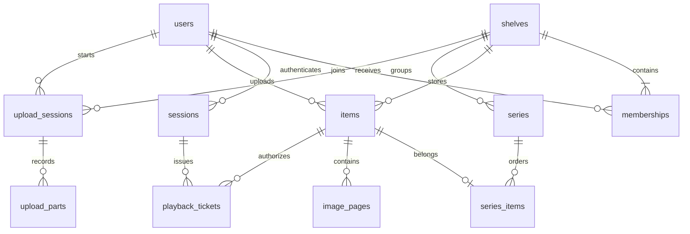

# アーキテクチャ

## 要件の対応

| 要件 | 実装 |
| --- | --- |
| PC WebとAndroid | 同一のWeb UIをブラウザとCapacitorアプリで実行 |
| クライアント・サーバー | `/api/v1` のHTTP APIを共通利用 |
| コンテナ実行 | マルチステージDockerfile、Compose、非root実行、永続ボリューム |
| クライアントからアップロード | 8 MiBの独立PUT・ハッシュ検証・DBで受信状況保持・再送／再開 |
| 動画・PDFのストリーミング | 動画のRange再生／シーク、PDF.jsの256 KiB単位の必要範囲取得 |
| アカウントと本棚の関連 | `memberships` 中間テーブルで多対多 |
| 紐付く本棚だけを閲覧 | 一覧、メディア情報、配信のそれぞれで所属確認 |
| 複数アカウントで同じ本棚 | 管理者が既存アカウントを閲覧者／編集者として追加 |
| 複数画像を1冊として閲覧 | 原画像を順序付きページとして、1冊のitemsとimage_pagesに保存 |
| 全コンテンツのサムネイル表示 | PDF先頭ページ・動画フレーム・画像本先頭ページをサーバーで生成 |
| 動画サムネイルのプレビュー | 必要時に最大6秒の縮小・無音MP4を生成。PCホバー／Android中央カードに同時1件 |
| 詳細閲覧記録と無期限保存 | 生イベント＋ページ滞在／動画区間集計。再送IDの重複排除。本人詳細／管理者匿名集計の分離 |
| 続きから再開 | 本人ごとに動画時刻・本のページ／スクロール／倍率をasset_progressに保存。revisionで競合検査 |
| 暗号化ダウンロード | AES-256-GCM分割をIndexedDBへ保存。各オープンでオンライン認可し、RAM上だけの鍵で必要範囲を復号 |
| シリーズ管理 | 本棚内のseries・series_items。混在メディアの手動順、巻話ラベル、同時編集検査、閲覧中の前後移動 |

## データモデル

- `users`: メールアドレス（一意、大小文字を区別しない）、表示名、scryptハッシュ。
- `shelves`: 名前と説明。ファイルは必ず1つの本棚に属する。
- `memberships`: `(shelf_id, user_id)` が主キー。管理者は本棚作成時にトランザクションで作成し、本棚当たり1名の制約を持つ。
- `items`: タイトル、元ファイル名、MIME、バイト数、登録者。実ファイル名はサーバー生成UUIDで、元の名前をパスには使わない。
- `image_pages`: 画像の本のページ番号、元ファイル名、MIME、原画像のサイズ・表示寸法。`(item_id, page_number)` が主キーで、送信順を保持する。
- `sessions`: 7日で期限切れ。ランダムなBearerトークンをクライアントに返し、DBにはSHA-256ハッシュだけ保存。
- `playback_tickets`: HTML videoでAuthorizationヘッダーを付けられないための1時間・1コンテンツ限定チケット。元セッションが有効で、かつ現在も本棚のメンバーである場合だけ配信する。
- `upload_sessions`: 開始者・本棚・開始時セッションID・タイトル・順序付きファイル情報・固定分割サイズ・状態・24時間の期限。処理中に開始セッションが無効になったら公開しない。開始セッションIDは後始末情報を保持するためsessionsへCASCADEしない。
- `upload_parts`: 0始まりのファイル／分割番号・サイズ・SHA-256。主キーは `(upload_id,file_index,part_index)` で、同じ分割の再送を重複登録しない。

パスワードは非同期scryptで計算し、平文は保存しません。Webのセッションは `sessionStorage`、Androidの接続先URLと再開用のアップロードID・期限は `localStorage` に保存します。再開用情報にトークンやメディアの実データは含めません。CSRF対策としてAPIの認証には明示的Bearerを使い、Cookieによる自動認証は採用していません。

## ファイルの流れ

1. 管理者／編集者だけがアップロードを開始できる。
2. 各ファイルを8 MiBで分割し、PUTごとに長さとSHA-256を確認して `uploads/transfers/<UUID>/` にストリーム保存する。受信済み分割をDBへ記録し、再送時は重複しない。クライアントもサーバーも大きな動画全体をバッファには展開しない。
3. サイズ・形式を検査する。画像は1枚ずつ完全にデコードし、静止画形式を検査して元のファイルのまま保存する。表示寸法とサムネイルにはEXIFの向きを反映する。
4. 全分割の受信後は202で応答し、永続化したジョブを直列処理する。ハッシュを再確認しつつステージングへ結合し、PDF先頭ページ・動画の代表フレーム・画像本の先頭ページをJPEGサムネイルにする。完了後にセッションと権限を再確認し、items・pages・ジョブ完了状態を同じDBトランザクションで公開する。プロセス再起動時は未完了ジョブを再処理する。
5. PDF.jsはBearer付きで256 KiB単位のRangeを取得し、自動先読みを止める。動画は限定チケットを発行し、GET / HEAD / Rangeで配信する。HLS変換は行わない。
6. 各配信リクエストで所属を再確認する。共有解除・ログアウト後の次のリクエストは拒否する。

サムネイルと画像ページの取得にも所属確認を行います。生成済みサムネイルは永続領域に保存し、クライアントでは認証付きで取得します。PDF.js・画像デコードはメモリ上限と30秒の制限付きWorker、FFmpegはタイムアウト付き別プロセスで動かし、重い変換は直列化します。ファイルの安全性を網羅的に検査する仕組みではありません。

動画カード用クリップは任意の派生キャッシュとして `previews/<UUID>.mp4` に保持します。DBスキーマは変えず、要求時に有無を確認し、必要時だけ既存の直列変換キューへ入れます。同一動画の並行要求をまとめ、待機枠も全体4件までです。クリップ取得の認証と所属確認は本編から独立して行い、元動画をカードへ直接読み込みません。クライアントでは1件だけ小さなBlobを保持し、画面遷移・非表示で停止・解放します。[詳細](video-previews.md)

すでに配信を開始したレスポンスや、クライアントに取得済みのデータを後から回収する機能はありません。DRMは実装していません。分割転送の通信失敗では再開用データを期限まで保持し、明示取消・生成失敗・生成完了では回収します。期限切れセッションは起動時と30分ごとに回収します。互換multipart APIは同期処理で、通常のエラーでは一時ファイルを削除します。OS強制終了時は孤立ファイルが残り得るため、運用メモの回収手順を使用します。

DBスキーマv1〜v4からv5への更新では既存itemsを引き継ぎ、画像の本・ページテーブル・分割アップロード管理・閲覧記録を追加します。v2のページには既存JPEGを表すMIMEを補完します。既存セッションと閲覧チケットを維持し、外部キー整合性を確認します。既存メディアの不足サムネイルは初回要求時に生成します。閲覧記録は削除・共有解除でも失わないよう元アセット・ユーザーからのCASCADEを持たず、analytics_views→events/pages/video_binsだけが外部キーで結び付きます。[指標・権限・容量と制限](analytics.md)

## 拡張の境界

v8ではseries・series_itemsと同一本棚制約用トリガーを追加します。既存のitems・進行度・履歴・暗号化ダウンロード・鍵は変更しません。1アセットは最大1シリーズ。シリーズ削除は中間テーブルだけへCASCADEし、アセットは消しません。アセット削除は所属だけを解除してシリーズrevisionを増やし、古い編集画面からの復活・上書きを防ぎます。[シリーズ仕様](series.md)

v7ではencrypted_downloadsとDATA_DIR/keysのマスター鍵を追加します。既存の履歴・再開位置を保持し、鍵はDBと一緒にバックアップします。[暗号化保存とオンライン認可](downloads.md)

v6では本人ごとのasset_progressを追加します。再開用の現在位置なので元アセット・ユーザーの削除に追従しますが、v5の無期限分析ログは維持します。[再開・競合・保存の仕様](progress.md)

初期版は単一プロセス・SQLite・ローカルストレージです。SQLiteのデータ領域を複数レプリカやネットワークファイルシステムで共有しないでください。将来複数サーバーにする場合は、PostgreSQLなどのDBとS3互換ストレージに移行し、ファイル配信・アップロードの実装を差し替えます。HLSやサムネイル生成はキューと別ワーカーに分けることを想定します。

メールサービスや外部ストレージの契約は不要です。外部サービスへメディアを送信する処理はありません。PDF用フォント・CMap・WASM・Workerはサーバー／APKに同梱します。
