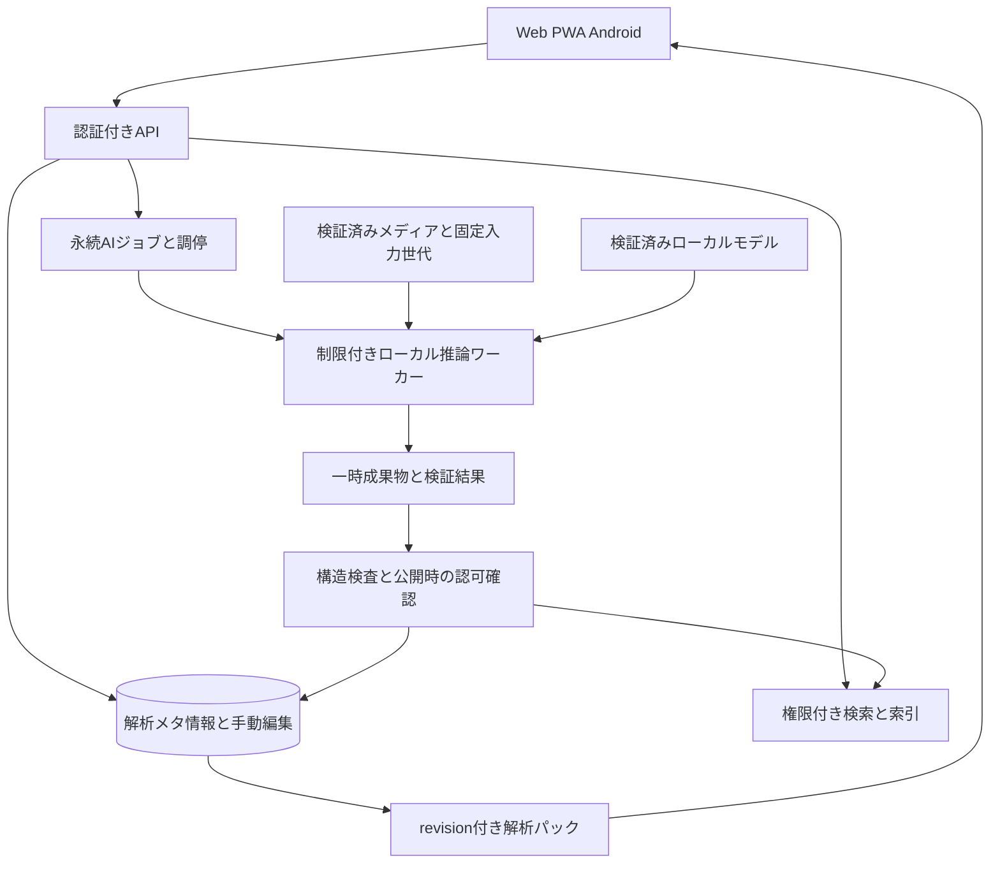

# Mirea 2.0.0 ローカルAI機能仕様・追加提案

[ドキュメント案内](../README.md) · [現行の全体設計](overview.md)

本書は2.0.0に向けた製品仕様と追加提案です。[実装設計](ai-implementation.md)に現在のコード、採用範囲、制約を記載しています。公開版の利用方法は[対象版と検証範囲](../status.md)で区別します。未採用の提案や数値目標を、公開済み機能・検証済みの性能保証として扱いません。

本書で「必須」とする項目は実装時の成立条件、「提案」とする項目は今回追加した製品仕様案です。採用モデルとCPU/Vulkanの導入は[管理者向け手順](../operations/ai.md)を参照します。モデルの実行成功と、分野・言語ごとの品質評価は区別します。

## 1. 目的と基本方針

本・漫画・音声・音楽・動画の内容をローカルで解析し、作品の整理、内容検索、該当ページや時刻への移動に利用します。PCで大量に整理し、AndroidやPWAで外出先から繰り返し利用する流れを対象にします。

| 区分 | 仕様 |
| --- | --- |
| ローカル完結 | 推論、OCR、音声認識、埋め込み生成、索引、検索、再評価を導入先サーバー内で処理する |
| 解析品質 | 重い解析を永続ジョブとして実行し、文字・構造・時間情報を複数段階で照合する |
| 操作応答 | 検索・閲覧・再生・転送を優先し、保存済み解析結果と索引を使用する |
| 端末 | Web、PWA、Androidに共通の解析結果を提供し、操作方法は各端末に合わせる |
| 大量利用 | 増分解析、対象の絞り込み、一括操作、途中再開、検索結果の分割取得を備える |
| 修正の保護 | 利用者が修正した文字、タグ、区間、章を独立して保存し、再解析時に再適用する |
| 情報の扱い | 解析結果、検索結果、候補、件数、端末保存にも元アセットの閲覧権限を適用する |

モデルの導入は、管理者が管理画面から公式配布元の固定版を別途ダウンロードする方式を標準とします。ローカルファイルの取り込みも用意し、接続できない導入先で利用できます。取得先・容量・ライセンス・検証情報を確認してから開始します。推論プロセスの外向き通信は遮断し、外部API、外部OCR、外部の文字起こし、外部の埋め込みサービス、遠隔テレメトリーへの自動送信を禁止します。モデル取得は専用の導入処理が行い、取得済みモデルの起動・推論は接続なしで成立させます。

## 2. 2.0.0の範囲と追加提案

### 2.1 中核機能

| ID | 機能 | 必須の利用者体験 |
| --- | --- | --- |
| AI-01 | 全アセットのタグ保存 | 手動タグと自動タグで検索・絞り込み・一括整理できる |
| AI-02 | 書籍・漫画の文字認識 | 本文やセリフを検索し、該当ページ・位置を開ける |
| AI-03 | 音楽の構成解析 | イントロ、サビ、間奏等を見て、その区間へ移動・反復できる |
| AI-04 | 動画のチャプター認識 | 内容に基づく章を選び、対応時刻から再生できる |
| AI-05 | 内容検索 | 作品名、タグ、本文、セリフ、発話、章名から探せる |
| AI-06 | 解析結果の編集 | 誤認識の訂正・採用・非表示・再解析ができる |
| AI-07 | 解析ジョブと管理 | 大量の依頼、負荷制御、中断・再開、失敗分の再実行ができる |
| AI-08 | 端末保存と権限 | 保存済み作品の解析情報を外出先でも使える |

AI-01にはAIの準備状態に依存しない手動タグを含めます。AI-05は全文・絞り込み検索を必須とし、自然文による意味検索も2.0.0の対象とします。自然文検索は入力された短い検索文をローカルでベクトル化して保存済み索引へ照会します。

### 2.2 本書で追加する提案

| ID | 提案 | 目的・実装のまとまり |
| --- | --- | --- |
| AI-X01 | 時刻付きの音声文字起こし | 動画の章生成・発話検索に使用。音声コンテンツでも任意に有効化 |
| AI-X02 | 関連作品・関連箇所 | 内容が近い作品や箇所を、根拠タグ・共通内容とともに表示 |
| AI-X03 | 条件を保存するスマートリスト | タグ、種類、本棚、解析済み条件で更新される本人用一覧 |
| AI-X04 | タグ・解析情報の書き出し | 人が修正した整理情報を再利用・バックアップしやすくする |
| AI-X05 | ネタバレ表示制御 | 検索スニペット、要約、章名、タグの表示量を選べる |
| AI-X06 | 解析結果の確認一覧 | 精度の低い箇所、未解析箇所、手動確認が必要な箇所をまとめて扱う |

開発中のコードはAI-X01の時刻付き文字起こし、AI-X02の共通タグによる関連作品、AI-X03の検索条件保存、AI-X04のJSON書き出し、AI-X05の検索抜粋の表示切替、AI-X06の未解析分と旧訂正の確認を採用しています。提案全体の実装と同一視せず、詳細は[採用範囲](ai-implementation.md#採用範囲と追加提案)を参照してください。大規模な対話チャット、全自動の改名・移動、メディア内容の生成・改変は将来検討項目です。

## 3. 初回設定と日常の流れ

### 3.1 管理者の準備

1. 管理画面の「AI機能」で解析機能を有効化する。初期状態は無効とする。
2. 機能別モデル、利用条件、必要なRAM・VRAM、ディスク容量を確認する。必要な同意・配布元のアクセス許可を得て、固定版をダウンロードし、ハッシュ検証後に導入する。
3. CPU実行または対応するGPU実行を選び、短い自己診断で利用可能性を確認する。
4. 付属の合成資料を使う自動自己診断の結果を確認し、解析時間帯と資源上限を設定する。モデルごとの品質評価は開発側が20節の計画に従って実施する。
5. 対象本棚で有効化し、既存アセットの解析件数・対象種類・見積容量を確認して開始する。

Webサービス本体の通常利用とAIの準備を独立させます。機能ごとの利用可否をクライアントへ返し、モデル準備中には使える検索・手動タグ・既存の再生を提供します。画面にモデルの内部識別子を常時表示せず、詳細設定で確認できるようにします。

### 3.1.1 モデルの配布と取得

モデルの重みと、モデルに付属するトークナイザー・辞書・モデル固有の設定・学習済み資源等は別途取得する配布物として管理します。Mireaのソース、Git LFS、Release添付物、コンテナの各イメージ層、サーバー配布アーカイブ、APK、PWA配布物へ同梱しません。ビルド時のモデル取得・キャッシュ混入も配布物検査の対象とします。Mireaが持つのは、取得元、固定revision、ファイル一覧、サイズ、ハッシュ、ライセンス参照、互換性等の導入に必要なメタ情報です。

1. 管理者が機能とモデルを選び、配布元、版、必要容量、利用条件を確認する。
2. 同意が必要な条件を表示し、管理者が明示的に確認する。配布元への申請・同意が必要なモデルでは、その提供元の手順を案内する。
3. 専用の取得処理が公式配布元から保存先へ直接ダウンロードする。Mireaが運営するミラーや再配布用のモデルパックは用意しない。
4. 固定revision、サイズ、ハッシュ、対応形式を検証し、完全なファイル一式を確認してから有効化する。
5. モデルID、取得元、ライセンス識別子・版・本文参照、確認者・日時を導入記録へ保存する。

別途取得するモデルにも、そのモデルの利用・表示・商用利用・サービス提供等に関する条件を確認します。例えば一部のモデル規約は利用そのものと遠隔サービスによる提供を対象に含めます。アクセス制限付きの配布先では、申請や利用者本人のアカウントでの認証が必要な場合があります。具体的な適用条件は採用するモデルの固定版ごとに確認します。[モデル利用規約の例](https://ai.google.dev/gemma/terms)、[Hugging Faceのアクセス申請と取得](https://huggingface.co/docs/hub/en/models-gated)

推論ランタイム、アダプター、ネイティブライブラリ等のMirea側で配布するコードは、依存物ごとのライセンスを確認し、必要な表示・文書・ソース提供等を扱います。モデルの別途取得と配布コードのライセンス管理をそれぞれ記録します。

モデル取得は中断・再開・取消に対応し、空き容量不足や配布元のアクセス拒否を区別します。自動の初回取得、予告のない版更新、利用条件の代理同意は行いません。条件やモデル版の更新時は影響を表示し、必要な再確認を経て切り替えます。

### 3.2 本棚の設定

本棚所有者が、機能ごとの自動解析の有効化、対象の種類、既存分の解析を設定します。サーバー管理者は全体で利用可能な機能と資源上限を管理します。

- 通常本棚とプライベート本棚は、それぞれ明示的に有効化する。
- 有効化後に公開された新規アセットを解析待ちへ登録する。
- 既存アセットの初回解析は、対象と件数を確認して依頼する。
- 本棚、シリーズ、アセットの順で対象指定を細かくできる。シリーズ一括操作では子シリーズを含むか確認する。
- 自動解析を無効化した後は新しい自動依頼を止め、既存結果の利用・削除と実行中処理の扱いを別に選べる。

### 3.3 利用者の最短経路

作品を追加すると、受信・通常の公開処理を経て閲覧できるようになり、AI解析が進むにつれてタグや内容検索が使えるようになります。検索結果の「12ページ」「03:20」等を選ぶと、その箇所を直接開きます。

日常の一覧に全件の解析状態を並べず、プロパティ、検索対象の説明、解析管理画面で必要な状態を確認します。利用者が操作できるエラーは「対象を確認」「再試行」等の行動と結び付けます。

## 4. ライブラリとタグ

### 4.1 タグの保存範囲

- 共有タグの辞書は本棚単位とし、付与情報はアセットに所属する。現在の本棚の編集権限を持つ利用者が変更し、統合・改名の影響もその本棚内に限定する。
- 個人タグの辞書は本人単位とし、本人だけが使う。本棚をまたぐ検索でも元アセットの現在の閲覧権限を検査する。共有タグの変更や他人への公開に影響しない。
- 自動タグには解析元、生成日時、モデル・解析仕様版、根拠の参照、確かさを保持する。
- 「手動追加」「自動提案」「採用済み」「非表示」を区別する。
- 高確度の自動タグは本棚方針に従って検索に採用し、低確度の候補は確認一覧へ置く。採用閾値はモデルの生スコアではなく検証済みの機能別基準で決める。
- タイトル・本棚名・シリーズ名・既存の説明を補助情報として使った場合も、メディア内容に基づくタグと由来を区別して記録する。

本は本文とページ画像、音声は音響特徴と利用可能な発話、動画は映像と音声から根拠を取得します。表紙だけで作品全体のタグを確定せず、長い作品では全体を走査して必要な箇所を詳細解析します。抽出範囲と未確認範囲を記録します。

ジャンル、題材、雰囲気、表現形式、言語等のカテゴリを用意します。細かな分類体系は編集できるタグ辞書で管理します。実在人物の同定、健康状態・思想・性的指向等の機微な属性の推定は対象外とします。

### 4.2 操作

作品のプロパティに「タグ・内容」タブを設けます。PCは複数選択後の一括編集、タッチ端末は既存の長押しメニューから開きます。通常クリック・タップは現行どおり作品を開きます。AIの提案から改名・移動・シリーズ所属変更を行う場合は対象と変更内容の確認を必須とし、無操作で原本や階層を書き換えません。

| 操作 | 動作 |
| --- | --- |
| タグを選ぶ | 現在の閲覧範囲で絞り込み。複数タグの「すべて一致」「いずれか一致」を選べる |
| 一括追加・解除 | 対象件数と共有／個人の保存先を確認して適用 |
| 自動タグの訂正 | 元の提案と訂正を保持し、次の解析でも訂正を優先 |
| 候補の却下 | 再解析後も同じ概念の自動再採用を抑止。解除操作を用意 |
| 表記の統一 | 表示名と正規化キー、明示した同義語で検索。自動のタグ統合は候補確認を経る |
| タグの統合・改名 | 共有タグは権限と影響件数を確認。個人タグは本人の範囲で操作 |

既定の詳細カードは現在のサムネイル表示を維持し、タグはプロパティと検索条件で使います。カードへのタグ表示は利用者が追加表示を選ぶ方式を提案します。

## 5. 検索と結果の操作

### 5.1 検索対象と条件

既存のタイトル検索を拡張し、タイトル・シリーズ名、タグ、書籍本文／セリフ、発話、チャプター名を検索します。文字列検索に加え、「料理の手順を説明している動画」のような自然文で探せるようにします。

- 現在の本棚・シリーズ・プレイリストを検索範囲の初期値にする。
- 種類、本棚、シリーズ、タグ、ダウンロード済み、解析情報の種類で絞り込める。
- 完全一致・部分一致の検索と、内容の近さによる検索を切り替えられる。
- 文字種、全半角、大小文字、読みの揺れを検索用の正規化で吸収し、OCR原文と手動修正は保持する。
- タイトルや明示タグの一致を分かりやすく扱い、類似度だけで目的の作品を埋もれさせない。
- 未解析の作品はタイトル・手動タグ等の利用可能な情報で検索できる。「検索できる範囲」を確認する入口を用意する。
- 新しい検索結果は要求世代で識別し、入力変更後に遅れて届いた旧結果を採用しない。

### 5.2 結果画面

検索結果はコンテンツ一覧と同じ画面内に表示します。既定は作品単位のまとまりとし、該当箇所を展開できます。「該当箇所」表示へ切り替えるとページや時間区間を一覧にできます。

各行には作品名、所属本棚・シリーズ、該当ページ／時刻、一致の理由を示します。スニペットと要約はネタバレ設定に従います。同一作品の多数一致には「ほかの一致」を用意し、ページングと件数上限で表示を制御します。

- 作品本体を選ぶと既存の開始・レジューム動作を使う。
- ページ・時刻を選ぶと明示位置を優先し、ページ内の該当箇所を一時的に強調する。
- 別の一致へ移動しても同じリーダー／プレイヤーの枠を使い、閉じた後に検索条件・スクロールを復元する。
- 候補の先読みは閲覧記録に加算せず、実際の表示・再生から記録する。
- 連続再生で次の作品へ進むときは先頭から開始し、検索で指定した位置を次作品へ引き継がない。

### 5.3 応答性能

全文索引、タグ索引、アセット／区間の埋め込みを解析時に作ります。自然文検索では短い検索文の埋め込みだけを高優先のローカル枠で生成し、索引へ照会します。重い全文生成や動画再解析は解析ジョブへ回します。

意味検索が時間予算を超えたときは、文字列・タグの検索結果を先に表示し、内容検索は明示した追加結果として提示します。表示済み行を自動で並べ替えず、利用者が採用した時点で更新します。通常検索の入力ごとに生成AIの長文応答を待つ構成は採用しません。

## 6. 本・漫画の認識とリーダー

### 6.1 入力と処理

| 入力 | 処理 |
| --- | --- |
| 画像書籍 | 原画像と現在のページ順・回転を基準に文字領域を抽出し、縦書き・横書き・読み順を認識 |
| PDF | 埋め込み文字を座標とともに抽出。画像領域や文字情報が不十分なページへOCRを適用 |
| EPUB | 検証済み本文構造から章・段落を抽出。本文を含む画像はOCR対象にできる |
| 漫画 | 吹き出し、ナレーション、擬音等の領域を分け、本文と読む順序を保存 |

日本語を優先評価言語とし、英数字混在・縦書き・ルビ・小文字・見開き・傾き・多段組・装飾文字を評価に含めます。言語ごとの対応品質を設定画面へ表示します。

高解像度の原画像は領域分割と余白付きタイルで処理し、同じ文字の二重認識を統合します。ページの巨大な展開画像を同時にRAMへ固定せず、ページ単位の資源制限を設けます。既存の画像書籍の受入条件をAI都合で変更する場合は、別途仕様確認を要します。

### 6.2 保存する内容

- 原抽出文字、OCR候補、採用文字、手動訂正、言語、領域種別、読む順序。
- PDF／画像本の1始まりページ番号、原ページID、回転、正規化座標、領域間の関係。
- EPUBのspine・文書要素等からなる安定位置、構造版、前後の短い照合文字列。
- 文字・領域・ページごとの品質指標と、その指標の定義。
- ページ単位の成功・失敗・保留と、使用した入力世代。

EPUBの位置は画面上のページ番号に固定しません。PDFの紙面上のページラベルと内部ページ番号は別に扱います。ページ順が変わった場合は原ページIDを再対応させ、対応できない手動修正を確認対象として保持します。

### 6.3 リーダーの操作

「本文を検索」「認識した文字を表示」「認識文字を修正」を用意します。文字表示は切替式の重ね表示とし、レイアウトを保ちます。領域を選ぶと認識文字を確認・コピーでき、読む順序も修正できます。

OCR抽出結果からのコピーには選択領域単位を用意し、ルビ・擬音を含めるか選べるようにします。解析情報の取得と次ページの先読みに独立した予算を設け、ページ表示を優先します。

文字の読み上げは追加検討項目とします。採用する場合はローカル音声合成、読み順、利用許諾、端末別の操作を別仕様として評価します。

## 7. 音楽の構成と音声コンテンツ

### 7.1 構成解析

楽曲全体を解析し、反復、音の変化、ボーカル有無、リズム等の根拠を用いて構成候補を作ります。短いサンプルのみから全体構成を確定しないことを必須とします。

| 保存項目 | 内容 |
| --- | --- |
| 区間 | 開始・終了を整数ミリ秒、元音源の時間軸で保存 |
| 区分 | イントロ、Aメロ、Bメロ、サビ、間奏、アウトロ、構成未確定等 |
| 繰り返し | 同じ構成グループと1回目・2回目等の出現順 |
| 根拠 | 反復・ボーカル有無等の構造化情報、解析仕様、検証済み確かさ |
| 編集 | 利用者による名称・境界・結合・分割、非表示 |

楽曲の形式に応じて「区間A」「区間B」等の中立な名前を使えます。クラシック、インストゥルメンタル、ライブ、メドレー等を対象に含め、判断が難しい境界は候補として残します。タグによる雰囲気分類と、実際の構成区間は別の結果として保存します。

### 7.2 プレイヤーの操作

- シークバーに構成の境界を表示し、区間一覧から移動できる。
- 「サビへ移動」は現在位置以降の次のサビを選ぶ。末尾なら先頭のサビを選ぶ。移動先の時刻を確認できる。
- 区間を選んでA–Bリピートできる。開始・終了を利用者が微調整できる。
- 区間リピート中はその区間を優先し、終了時のシリーズ移動を保留する。解除時に通常のリピート／シャッフル設定へ戻る。
- 別作品へ移動した時点で区間リピートを解除し、前作品の時間範囲を持ち越さない。
- A–B範囲は開始時の値を保持する。解析更新・区間訂正だけで現在のループ境界を動かさず、区間を選び直した時点で最新版を使う。
- 構成表示と再生頻度グラフは意味と表示を分け、構成を再生回数として描画しない。
- 解析結果の公開で、再生位置・音量・速度・イコライザー・再生キューを初期化しない。
- シャッフルや連続再生は既存のシリーズ／プレイリストの範囲と順番を尊重する。

「サビだけを順に再生する」は追加提案とし、採用時は専用の再生モードとして明示します。

### 7.3 音声文字起こしの提案

講義、会話、朗読等の音声に時刻付きの文字起こしと話題区切りを生成し、発話から検索できるようにします。話者番号は同一アセット内の区別に使い、実在人物名を自動同定しません。音楽の歌唱文字起こしは独立した任意機能とし、構成解析の成立条件にしません。

## 8. 動画のチャプターとプレイヤー

### 8.1 チャプター生成

映像の場面変化、時刻付き音声認識、画面内文字、既存チャプターを組み合わせて内容上の区切りを推定します。静止画サンプルの抽出間隔・追加調査箇所・音声区間の対応を記録し、短い場面の見落としを評価します。

チャプターごとに開始・終了、短い見出し、任意の要約、根拠区間、生成元を保存します。境界の過剰分割・長い空白・無音・エンドクレジット等を確認する工程を設けます。章名と要約は該当映像・発話で確認できる範囲に限定します。

### 8.2 既存情報との関係

- 手動のチャプター・字幕を優先し、AI結果は別の候補集合として保持する。
- 埋め込みチャプターは由来付きで取り込み、既存の手動指定と照合する。
- 既存章がある場合は「現在の章を使う」「AI案と比較」「選んで適用」を用意する。
- 手動章がない場合は、本棚方針に従って検証済みのAI章を表示できる。
- 字幕・文字起こしは共通の時間軸と権限で扱う。字幕ファイルのインポートや従来の操作との互換を設計する。

### 8.3 操作

シークバーと既存チャプター一覧から章へ移動できます。「動画内を検索」から発話や画面内文字に一致した時刻を開きます。章一覧・検索結果のパネルは既存の重ね表示／固定表示の設定を尊重します。

章画像と追加の解析情報は遅延取得します。再生開始・シーク・PiP・バックグラウンド再生へ移行した後も同じ再生セッションを保ちます。チャプターの変更だけで配信メディアの世代を作り直しません。

## 9. 関連作品・スマートリスト・ネタバレ制御の提案

### 9.1 関連作品と関連箇所

同じタグ、内容の近さ、明示した言語・種類などを根拠に、閲覧できる作品を提示します。別種類の作品も候補にでき、同一種類へ絞れます。「共通する題材」等の理由を確認できるようにします。

検索や提案の順位付けへ他人の私的な閲覧履歴を使用しません。本人の履歴を使う個別最適化は将来の明示的な選択項目とします。プライベート本棚の結果は解除済みの専用範囲だけで扱います。

### 9.2 スマートリスト

本人が条件を保存し、コンテンツ一覧で開けるようにします。条件は種類、本棚、シリーズ、共有／個人タグ、解析済み範囲等を組み合わせます。権限のない項目は評価対象から除外します。

音楽・動画の連続再生は同一種類に限定し、開始時に対象と順番のスナップショットを作ります。再生中の解析更新で現在のキューを組み替えず、「一覧を更新」で次回の対象を確認できます。既存の手動プレイリストへ結果をコピーする入口を用意します。

### 9.3 ネタバレ設定

本人の設定として「内容を表示」「自動生成した内容は操作時に表示」を用意し、作品・シリーズ単位で上書きできる案とします。後者ではOCRスニペット、生成要約、生成章名、内容を明かす自動タグを操作時に表示します。操作には「第3章」「12ページの一致」等の中立な表示を使います。

閲覧位置から「見終えた」と自動判断する機能は別途評価し、初期仕様では本人の選択を基準にします。

## 10. 結果の編集と再解析

| 種類 | 編集権限・保存範囲 |
| --- | --- |
| 共有タグ、OCR訂正、音楽区間、動画章 | 現在の本棚の所有者／編集者 |
| 個人タグ、検索条件、スマートリスト、表示設定 | 本人 |
| 単体の手動解析依頼 | 所有者／編集者、および現在の閲覧権限を持つアセット登録者 |
| 本棚全体の方針と一括解析 | 本棚所有者 |
| サーバー資源・モデル導入・管理ジョブ | サーバー管理者。コンテンツ参照は既存の認可境界に従う |

閲覧者は権限付きで解析結果を読み、誤りを確認できます。共有内容の変更権限がない場合は、編集可能な利用者へ誤り箇所を渡せる仕組みを追加提案とします。

原抽出結果、公開結果、人の編集を別の履歴として保持します。人の編集は変更前revisionと冪等な操作IDを要求し、同時編集の競合では409と再確認を返します。変更箇所を比較してから再適用できるようにします。直前の変更や保存済みの編集版を比較・復元する入口を用意し、復元自体も新しいrevisionとして記録します。

再解析では入力世代・解析仕様・モデル版を記録した新しい結果を作り、検証後に公開参照を切り替えます。旧結果の保持数・期間は管理設定で上限を設け、人の訂正・却下・採用指定は整理対象から保護します。入力差し替えで訂正位置が対応しなくなった場合は「対応の確認が必要」として残します。

再解析の範囲は「未解析」「失敗・不足分」「古い解析仕様」「全て」を選べます。強制再解析は対象件数と既存結果への影響を確認して依頼します。

## 11. オフラインと接続変更

### 11.1 端末へ保存するもの

| 保存内容 | 初期方針 |
| --- | --- |
| タイトル・シリーズ・表紙・軽量な公開タグ | 現行カタログに適合する小さな射影として自動同期 |
| OCR全文・字幕・文字起こし・詳細区間 | 本体ダウンロード時に対応パックを保存 |
| 内容検索用の端末索引 | 保存済みの詳細情報から差分生成 |
| 端末内の意味検索モデル・埋め込み | 容量・性能評価後の追加検討。初期の端末検索は文字列・タグを必須とする |
| 大きな全件解析情報 | 本棚・シリーズ単位の明示した保存操作で取得する案とする |

プライベート本棚のOCR全文、文字起こし、要約、タグ、埋め込みは追加解除の対象とします。現行カタログのメタデータが含まれることを理由に、解析全文を通常カタログへ同梱してはいけません。

新しい解析パックにはアセットID、入力世代、解析revision、形式版、容量、チェックサムを含めます。メディア本体の保存登録と解析パックのrevisionを分け、OCR訂正だけで本体を再取得しない設計とします。

### 11.2 利用と同期

- 保存済み作品の全文・タグ検索、ページ・区間ジャンプ、章・構成表示を提供する。
- アセット本体の視聴許可と解析パックの閲覧許可を現在のセッション・本棚権限へ結び付ける。
- 詳細解析情報の保存期限は現行の最長7日の認可期間を越えない。
- プライベート本棚はAndroidの生体認証／パスワード、Web/PWAのパスワードによる既存の追加解除を適用する。
- アカウント・サーバーを保存領域の区分とし、ログアウト・権限失効時はパック・索引・候補キャッシュを利用不能にして消去を予定する。
- 再接続時はrevisionの差分と削除通知を取り込み、一覧のスクロール・プレイヤー・検索条件を維持する。
- 取得が途切れた場合は検証済み単位から再開し、途中パックは検索へ公開しない。
- 全件検索と保存済みの範囲が異なる場合は「この端末に保存した内容を検索」等、利用できる範囲だけを表示する。

初期の共有解析編集は接続中に行います。個人タグのオフライン編集を採用する場合は操作ID・基準revision・競合確認を設計し、未同期の変更を接続先変更後に別サーバーへ送信しません。

## 12. 解析基盤と既存機能との接続

### 12.1 責務

APIプロセスが永続ジョブの状態遷移と公開DB更新を所有します。推論ワーカーは限定された入力と作業領域だけを使用し、全DBやサーバー鍵へ直接アクセスする構成を避けます。検索プロセスの索引は認可済みの範囲を扱い、APIで要求・応答を検証します。

### 12.2 通常アップロードとの関係

1. 受信完了で送信枠を解放し、既存の取り込みがアセットを公開する。
2. 表紙、トランスコード、プレビューは既存のレーン・依存関係で処理する。
3. AIは検証済みの入力を固定できた機能から専用キューへ登録する。
4. タグやOCR等が準備できた段階で独立した解析結果を公開する。

AIの遅延・失敗は、公開済みメディアの閲覧可能状態と区別します。通常の受信完了・原本再生・ダウンロード準備へAI完了を追加条件にしません。AI自動解析はアップロード先の本棚方針をアセット公開時に再確認します。

### 12.3 入力の選択

書籍は原ページ・検証済みPDF／EPUB、音楽は保持原本または検証済み音源、動画は保持原本または配信世代を使い、使用した版と品質を記録します。原本保持OFFの場合は既存の原本回収条件と協調します。

実行中のジョブは入力世代をpinして回収を待たせます。一時停止・資源待ち・再待機中も、再利用するcheckpointが依存する入力世代を保持します。長期待機の保持を解放して別入力へ切り替える場合は、入力世代を更新して依存checkpointの対応を再検証し、影響する単位を再解析します。保持状況と解放時の再処理範囲を管理者に表示します。原本・配信データの変更で時間軸やページ対応が変わる場合は結果を無効化して再対応を行います。

全ファイルのハッシュ算出でアップロード完了を遅らせず、既存の入力識別情報を再利用し、足りない指紋計算をバックグラウンドで行います。

## 13. ジョブ、負荷制御、再起動

### 13.1 処理単位と状態

対象はアセット×解析機能×入力世代×解析プロファイルです。書籍はページ、動画・音楽は重なりを持つ時間区間でcheckpointを作り、全体の対応付け・構成判定を後段で行います。

状態は「依存待ち」「待機」「実行中」「一時停止」「資源待ち」「成功」「一部成功」「失敗」「取消」とします。機械的な状態名は実装時に定義し、理由コードとUI表示文を分離します。

- 同一対象の同じ依頼は一件へまとめ、複数端末からの再送に同じjob IDを返す。
- 正常終了、失敗、取消の全経路で枠を返し、次の実行可能な対象を拾う。
- 一時停止はcheckpointを確定して次の単位へ進む前に停止する。
- 終了期限内に停止しない子プロセスは終了を確認してから枠を返す。
- 再起動では実行中のleaseと作業ファイルを照合し、検証済み単位から再開する。
- 項目削除・入力変更・権限変更と競合した旧成果物は公開しない。
- モデル更新後も実行途中の版を固定するか、明示的に新しいジョブへ移す。

### 13.2 優先順位と公平性

| 優先順 | 処理 | 振る舞い |
| --- | --- | --- |
| 1 | ページ表示、再生、シーク、認証、軽い検索 | 予約した資源と短い要求期限で応答 |
| 2 | 送受信、通常取り込み、表紙、閲覧用データ準備 | 利用中操作のための帯域・I/Oを優先 |
| 3 | 短い検索文のローカル推論、閲覧中作品の明示依頼 | 専用の上限付き枠。重い再解析は通常キューへ登録 |
| 4 | 手動のAI解析依頼、自動解析 | ユーザー・本棚間で公平に処理 |
| 5 | 大量の再解析・索引再構築 | 低優先でcheckpoint単位に進行 |

手動依頼の連続投入による自動解析の永久停止を防ぐため、待機時間による繰り上げを設けます。ユーザー・本棚ごとの使用量と待機時間を確認し、同時数・キュー登録数の上限を管理します。受理した大量依頼はバッチ参照から順に展開し、一度に全件をRAMへ読みません。

GPUを通常トランスコードと共用する場合も、GPU資源を共同で調停します。レーンを独立させるだけでGPU・RAM・ディスクが無制限に使えると解釈しません。

### 13.3 資源

CPUスレッド、RAM、VRAM、同時推論数、モデル常駐量、一時領域、索引・成果物容量を制限します。入力の長さ、ページ数、展開量に応じて小さな単位に分割します。

空き容量の低下やメモリー不足時は、原因を資源待ちとして表示し、検証済み結果と再開位置を保持します。再試行は回数・間隔を制限し、同じ失敗を無限に繰り返しません。適用した品質設定を保存し、精度を下げるプロファイルへの切替は管理者が選べるようにします。

解析速度は参考値としてページ／分、音源分／処理分などを測定します。推定終了時刻には計測件数と不確実さを持たせ、計測が不足する場合は完了単位数と経過時間を表示します。

## 14. 高品質解析の基準

モデルの出力はデータとして検査します。時刻の範囲・順序、座標、タグの長さ、参照先、重複、JSON形式、全文の欠落等を検証します。ページや時間区間の未処理部分を品質レポートへ記録します。

| 領域 | 評価するもの |
| --- | --- |
| タグ | 人が付けた評価用タグとの適合率・再現率、不要タグ、表記の安定性 |
| 書籍 | 文字誤り率、領域の抽出、読む順序、ルビ、ページ・位置への到達 |
| 音楽 | 人の区間注釈との境界誤差、サビの適合率・再現率、構成未確定の扱い |
| 動画 | 意味的な区切り、章名と内容の一致、過剰分割、発話・映像の時間対応 |
| 検索 | 人が選んだ目的箇所の上位表示率、誤一致、全件／端末保存範囲の説明 |
| 操作 | 解析中の再生・ページ送り・転送・検索の遅延、復旧後の一貫性 |

モデル間の生スコアを共通の「正解率」と表示しません。確かさは機能別の評価で校正し、利用者向けには「確認をおすすめ」等の行動へ結び付けます。人の訂正を評価資料へ追加する場合も、本棚の設定と許諾を確認し、外部へ送信しません。

原文と認識結果の照合、別の認識候補による再確認、境界付近の再解析を品質向上手段として評価します。モデルの規模や処理時間の長さだけで品質向上と判定しません。

## 15. データ、索引、公開の整合性

### 15.1 論理データ

次は追加を提案する論理エンティティです。物理テーブル名、DBスキーマ番号、列の定義は実装設計時に確定します。

| エンティティ | 主な保持内容 |
| --- | --- |
| 解析方針 | 本棚・機能・自動実行・品質プロファイル・設定revision |
| モデル登録 | モデルID、固定revision、取得元、ファイル一覧・サイズ・ハッシュ、ライセンス識別子・版・本文参照、確認者・日時、互換性、導入状態 |
| 解析依頼 | 対象、要求者／認可根拠、入力世代、機能、プロファイル、状態、lease、時刻 |
| checkpoint | ページ／区間、試行、検証済み成果物、次の実行単位 |
| 解析版 | 入力世代、pipeline版、モデル群と設定hash、実行ID、公開revision、範囲 |
| タグ定義・付与 | 正規化キー、表示名、カテゴリ、範囲、由来、採用／却下 |
| 文字ブロック | ページ／構造位置、領域、文字、読む順、確かさ |
| 時間区間 | メディア時間軸、開始／終了、章／構成種別、根拠 |
| 手動編集 | 対象、作者、基準revision、編集内容、冪等操作ID |
| 検索射影 | 権限スコープ、公開revision、全文索引、ベクトル空間ID |
| 同期記録 | 解析パックのmanifest、revision、削除通知、取得状態 |

時刻は既存の整数ミリ秒に合わせ、ページは1始まりとします。画像座標は回転後の原ページに対する0〜1の正規化座標とします。埋め込みはモデル・次元・正規化仕様の異なる空間を混ぜず、検索文側と索引側の版を一致させます。

### 15.2 公開と競合

1. 対象アセット・入力世代・認可根拠を確認して処理単位を取得する。
2. 一時領域へ結果を書き、構造・容量・入力対応・チェックサムを検証する。
3. 公開直前に削除状態、所属、認可、入力世代、人の編集revisionを再確認する。
4. 短いDBトランザクションで解析版と公開参照を確定する。
5. 索引と同期射影を更新し、結果を取得できる状態を通知する。

索引への反映は再送可能な公開イベントとして永続化します。索引が遅れてもDB側の最新ACL・tombstone・公開revisionで検査してから返し、権限外のタイトル・件数・スニペットを応答へ含めません。新規結果の検索反映が遅れる場合は、解析完成と索引反映の状態を区別します。

OCRページ等の独立した結果は単位ごとに公開できます。楽曲構成・動画章は全体の整合検査後に公開します。一部成功では未処理範囲を保持し、再実行は不足分に限定できます。失敗した新しい版が既存の有効な結果を隠す状態を防ぎます。

実行・待機ジョブ、再開対象のcheckpoint、現行索引と検索文推論が参照するモデルは通常削除を抑止します。モデル変更・削除の操作では参照対象と影響を確認し、移行・取消・索引切替後に解放します。モデルが欠落・破損した場合は該当機能を準備不足として隔離し、文字列・タグ検索を提供しながら、同じ版・hashの検証済みモデルを再導入する入口を表示します。

モデル更新時は旧索引を利用しながら別世代を構築し、検証後に切り替えます。モデル常駐・索引容量を見積もり、途中で空き容量が足りなくなれば旧世代を使って新規構築を資源待ちにします。

### 15.3 移動・削除・保守

- 同じ内容のアセット移動・改名は解析本文を再生成せず、所属・検索射影・タイトル由来タグの見直しを行う。
- 本棚間移動では新しい方針・権限を適用し、元本棚の共有範囲に結果を残さない。
- アセット削除は依頼・推論を停止し、結果、索引、パック、キャッシュを削除対象に含める。
- 削除後に遅れて届いたワーカー結果はtombstoneと世代照合で公開を拒否する。
- 索引の削除待ちでも検索から即時除外し、再起動後に削除を再試行する。
- 解析結果のみの削除と、アセット・人の編集を含む削除を別の確認操作にする。
- バックアップ／復元・保守中は公開を調停し、整合したDB・手動編集・成果物を同じ時点で保存する。

## 16. 認可、プライバシー、入力の安全性

検索の候補生成・順位・件数・補完・関連候補を認可済み範囲へ限定します。private解除済み本棚でも、通常の「すべてのコンテンツ」や履歴と同じ非表示方針を引き継ぎます。プライベート検索は当該本棚を開いている範囲で行い、ロック後にスニペットや検索履歴を残さないようにします。

自動解析は本棚所有者が有効化した永続方針を認可根拠に実行します。対話用の追加解除トークンを長期ジョブへ保存しません。private本棚での手動依頼は解除を確認して登録し、実行・公開時は現在の本棚方針と要求者の権限を再確認します。自動方針を取り消した場合は、その方針に基づく依頼を次の安全な処理境界で停止します。手動依頼の要求者が必要権限を失った場合はその依頼を停止し、自動方針に基づく別依頼の有効性は現在の本棚所有者・方針で判定します。

メディア内の文字・音声は解析対象として扱い、そこに含まれる命令、URL、プログラムを実行しません。モデルにファイルシステム操作、シェル、HTTP取得等の汎用ツールを与えません。モデルの出力は許可した構造へ検証・変換して保存し、HTML等をそのまま画面へ挿入しません。

モデル取得用の資格情報は管理者が導入処理へ渡し、ログ・共有URL・通常API応答・標準バックアップへ含めません。推論処理へ取得資格情報を渡さず、認証が必要な配布元では最小限の読み取り権限を使用します。取得先とリダイレクト先を検証し、秘密のヘッダーを別のoriginへ転送しません。

モデル取り込みは配布元の信頼情報、固定ハッシュ、互換情報を検証し、任意コード実行が必要なモデル形式・読み込み方式を避けます。推論プロセスは非rootとし、入力は読み取り限定、作業領域は目的ごとに制限します。既存のコンテナ保護・ネットワーク境界・鍵保管を維持します。

OCR全文、検索文、発話、要約、タグ、埋め込みをプライベート情報として扱います。通常ログには件数、処理種別、時間、資源量、安全なエラーコードを記録し、本文やファイル名・パス・モデルプロンプトを記録しません。既存の「安全な詳細」「診断一括送信」は許可リスト方式を拡張し、解析内容を含めません。

## 17. 管理画面と利用者の確認画面

### 17.1 サーバー管理

「AI機能」に以下を配置します。通常の処理設定と共通の項目は同じ設定元を参照します。

- 機能ごとの有効／無効、公式取得先、固定版、ライセンス確認、必要容量、ダウンロードの進捗・中断・再開、検証結果、導入済みモデル、更新候補、再導入、自己診断。
- CPU・GPUの割当、RAM・VRAM・一時領域・保存容量の上限。
- 時間帯、同時実行数、公平性、索引の状態、資源待ちの原因。
- 本棚ごとの対象数、未解析・成功・一部成功・失敗、入力／モデルの旧版数。
- 解析・索引・モデル・作業ファイルごとの使用容量、回収可能な旧世代。
- バックアップ対象と、モデル等の再取得で復旧する項目。
- 設定の実効値、環境変数で上書きされている値、設定変更の反映時期。

モデルファイル、再生成可能な索引、人の編集を容量表示で分けます。環境変数は既存の設定方針に合わせて上書き用として扱い、通常設定を管理画面から完了できるようにします。

### 17.2 ジョブ管理

既存のタスク管理表にAI分類を加えます。転送状況は送受信に使用し、AIの待機行で埋めません。

行には対象、機能、状態、完了／全単位、開始日時、経過時間、推定残り、確認が必要な理由を表示します。詳細ではモデル・入力世代・処理段階・再試行可能な原因を確認できます。対象へ移動、一時停止、再開、取消、失敗分再実行を権限に従って提供します。

利用者は自分が依頼したジョブと閲覧・編集可能な範囲の状態を確認できます。管理者向けにはシステムの使用量を集計し、対象本文やプライベートな題名の開示は既存の認可設計に従います。完了通知は依頼バッチ単位でまとめます。

### 17.3 確認が必要な解析結果

本棚・種類・機能で絞れる一覧を提案します。低確度タグ、読む順序、未認識ページ、不自然な境界等を順に確認し、承認・訂正・後で確認を選べます。訂正直後に同じ箇所へ戻れるようにし、大量確認でも位置と選択を維持します。

## 18. API契約の案

以下は責務と要求内容の案です。パス名、payload、既存APIへ統合する範囲は実装時に[API仕様](../api.md)へ定義します。

| 操作 | 主な契約 |
| --- | --- |
| 能力・準備状態の取得 | 機能、対応版、利用可否、対象言語を返す。秘密の配置情報を返さない |
| 解析の依頼 | 対象スコープ、機能、品質方針、request IDを受理し202と永続job IDを返す |
| バッチの作成 | 対象集合・revisionを固定し、ページングして子依頼へ展開 |
| 状態・取消・再開 | 本人／本棚／管理権限を検査し、期待revision付きで操作 |
| 結果の取得 | 入力世代・結果revision・必要なページ／時間範囲を指定。ETagと304を使う |
| 共有結果の編集 | 基準revision、操作ID、検証済みpatch。競合は409 |
| タグ操作 | 共有／個人を明示。一括操作は件数と部分失敗を返す |
| 検索 | 範囲、文字列、検索方式、条件、上限、cursor。権限と索引世代へcursorを結び付ける |
| パックの取得 | 権限・private解除・有効期限・checksum・revisionを含むmanifestを返す |
| 書き出し | 認可範囲のrevision付きJSON、字幕は対応する標準形式を任意に提供 |

状態変更には冪等キーを用意します。大量操作の選択対象はサーバー側でsnapshotとして固定し、新たに追加された作品を意図せず巻き込みません。移動・権限変更・削除は実行時にも再検査します。

入力不正、準備不足、資源待ち、容量不足、モデル不一致、世代競合、権限喪失を安全なコードで区別します。HTTPは既存の401／403／404／409／422／429／503等の使い分けに合わせ、UIには必要な対処を表示します。

## 19. 保存・バックアップ・移行

解析メタ情報と人の編集はバックアップ必須とします。解析成果物も標準のバックアップ対象に含め、モデル本体・再構築可能な索引・一時ファイルは容量を明示して選べる設計とします。モデル本体の保存は明示的に選ぶ項目とし、モデルID・固定版・hash・取得元・ライセンス情報・導入時の確認記録を標準バックアップへ保存します。復元では同じ固定版を公式配布元から再取得するか、条件に従って保管したローカルファイルを取り込みます。配布元へ到達できない場合や必要なアクセス許可がない場合はモデル再導入を案内し、通常の一覧・閲覧を提供します。バックアップを第三者へ渡す場合は、含めるモデルの配布条件も確認します。

将来の配置は既存のDATA_DIR／MEDIA_DIRの責務に従い、解析状態・編集・索引・作業領域・モデルの論理区分を定義します。実パスと新しいマウントの要否は設計時に決めます。SQLite/WALを所有するAPIとワーカーの停止・snapshot順序を復元手順に含めます。

既存アセットには「未解析」を追加し、元のタイトル、所属、続き位置、履歴、手動章、カスタム表紙、暗号化保存のidentityを引き継ぎます。既存の文字情報があるPDF／EPUBは再利用可能性を検査します。

2.0.0のスキーマ移行前にデータ・メディア・設定を同時点で完全バックアップします。旧版への切り戻しは対応するバックアップを用います。サーバー／クライアントのメジャー互換性は既存の接続・更新方針へ従い、現行の更新情報署名やAPK署名のidentityを継続します。

## 20. 受入条件と検証計画

本節は実装後に実施する計画です。仕様書の作成時点でAI機能の実装検証は行っていません。合成または許諾済みの評価資料と、専用の独立した検証環境を使用します。

### 20.1 必須の成立条件

| ID | 合格条件 |
| --- | --- |
| AC-01 | 外向き通信を遮断した状態で、導入済みモデルによる全中核機能が実行できる |
| AC-02 | 各種類のアセットに手動／自動タグが保存され、検索・一括訂正・再解析後も意図した状態が保たれる |
| AC-03 | OCR一致から正しいページ・領域へ移動でき、縦書き・見開き・EPUB再レイアウトでも位置が対応する |
| AC-04 | 音楽区間と動画章が有効な時間範囲を持ち、区間ジャンプ・反復・既存の連続再生と両立する |
| AC-05 | 解析中にアップロード完了、原本再生、ページ送り、通常ジョブがAI依存で待機しない |
| AC-06 | 再起動・worker異常終了・取消・資源不足後に、重複公開と永久実行状態を発生させず復旧できる |
| AC-07 | 本棚移動・共有解除・privateロック・削除後に、検索候補・件数・補完・パックから権限外情報を返さない |
| AC-08 | 利用者の修正を再解析で保護し、同時編集・入力変更時に競合を確認できる |
| AC-09 | AndroidとPWAで、期限内に保存した解析情報の文字検索とページ・時刻ジャンプが使える |
| AC-10 | 接続切替と解析更新で、一覧位置・検索条件・再生セッション・音量等を保持できる |
| AC-11 | 旧版データの移行、完全バックアップ、空の復元先への復元、旧版への切り戻しを確認できる |
| AC-12 | 通常ログ・安全な診断・管理通知・書き出しの認可とプライバシーを確認できる |
| AC-13 | リポジトリ・Git LFS・Release・コンテナ全層・APK・PWA等へのモデル配布物と取得キャッシュの混入を検出できる |
| AC-14 | 条件確認、配布元の認証、取得中断・再開、ハッシュ不一致の拒否、資格情報の保護、モデルを省いたバックアップからの再導入を確認できる |

### 20.2 応答性能の仮目標

以下は実測後に確定する提案値です。基準ハードウェア、メモリー、モデル、回線条件、データ件数、cold／warmを評価報告へ併記します。

| 対象 | 初期の測定目標 |
| --- | --- |
| ローカルボタン・タブ・検索入力の反応 | p95で100 ms以内に反応を開始 |
| 文字列・タグ検索 | warm時のサーバー処理p95で300 ms以内 |
| 意味検索の最初の候補 | warm時のサーバー処理p95で1秒以内。cold時も先に通常検索を返す |
| タグ・章等の保存済み結果取得 | ページングした要求をwarm時p95で300 ms以内 |
| 解析併走時の通常操作 | 同一負荷条件で解析停止時に対するp95悪化を20%以内へ抑える案を検証 |
| 大量管理 | 10万アセット相当のメタ情報と大量待機ジョブで、一覧・一括操作・索引更新のRAM使用を測定 |

モバイル回線の総遅延はサーバー処理時間と別に測定します。端末保存済みの情報は端末内検索へ優先して照会し、圏外・LTE遅延・切断復帰での初回表示と操作を評価します。性能目標を超えた場合の資源調停と段階表示も受入試験へ含めます。

### 20.3 評価資料と障害試験

文字サイズ・言語・レイアウトが異なる本、会話・無音・雑音を含む音声、複数ジャンルの音楽、カットの多い映像と長時間の説明映像を用意します。誤りやすい資料を分け、人が付けた正解・区切り・検索目的と比較します。

小規模CPU構成、GPU構成、RAM不足、ディスク／一時領域不足、モデル欠落、互換性違い、入力削除、入力世代更新、権限喪失、同時訂正、停止直後の再起動、索引再構築中の検索を検査します。

画面確認はPCのキーボード／右クリック、スマートフォンのタッチ、PWA、Androidで行います。読み上げ支援のラベル、フォーカス、コントラスト、動きを減らす設定も含めます。AndroidのPiP・バックグラウンド・圏外切替は実機で確認し、自動テスト・ビルド成功と区別して報告します。

## 21. 実装前に確定する事項

| 項目 | 決める基準 |
| --- | --- |
| 機能別モデルとライセンス | 日本語・漫画・楽曲構造・動画の評価、ローカル利用・商用利用・共有サーバー提供の条件、必要な表示・同意、取得元の継続性、互換性。モデル重みと配布コードを個別に確認 |
| ローカル実行の範囲 | 初期案はMireaと同一ホストの専用プロセス。管理者指定の別のローカル機器を将来扱う場合の認証・通信・配布条件 |
| 最小／推奨性能 | CPUのみでの実用性、必要RAM・VRAM、通常操作との併走結果 |
| 品質プロファイル | 高品質の標準設定、領域再認識・再評価条件、手動で選ぶ代替設定 |
| 自動タグの採用基準 | 評価資料での適合率、誤タグの許容度、カテゴリと同義語 |
| 全文・ベクトル索引 | ACL付き候補抽出、大量データの応答、再構築・バックアップの容易さ |
| 数値上限 | タグ件数、本文・区間サイズ、batch数、同時実行、保管期間、パック容量 |
| オフラインの保存範囲 | 初期同期の容量、詳細パック、端末索引、追加モデルの必要性 |
| 追加提案の採用範囲 | AI-X02〜AI-X06の費用、UIの複雑さ、2.0.0中核機能の完成度 |
| 物理設計と移行 | テーブル、公開API、索引・モデル配置、世代保持、schema migration |

モデルやエンジンの名称は比較評価後に決定します。性能・品質の数値を満たす構成が定まった段階で、モデルID・版・hashと測定結果を設計書へ追記します。

## 22. 現行設計との対応と実装時の更新先

| 接点 | 現行の正本・実装入口 | 実装時に追加する検証 |
| --- | --- | --- |
| 受付・後処理 | [転送とジョブ](upload-jobs.md)、server/job-pool.js、server/media-pipeline.js | AI併走、公平性、永続化、再起動、入力pin |
| データ・削除 | [データモデル](data-model.md)、server/database.js、server/series-actions.js | 解析世代・手動編集・tombstone・移行・復元 |
| 認可 | [セキュリティ](security.md)、server/private-shelves.js | 検索・集計・パック・自動依頼の認可 |
| 本 | [書籍](books.md)、web/src/book-viewer.js | 座標・読む順・EPUB位置・先読みとの優先調停 |
| 音楽・動画 | [再生](playback.md)、server/video-navigation.js、web/src/video-player.js | 区間・章の編集、明示位置、連続再生、PiP |
| 同期 | [端末保存と同期](offline-sync.md)、web/src/offline-vault.js | 解析パック差分、暗号化、期限、ユーザー切替 |
| 整理 | [本棚と作品](../user/library.md)、server/playlists.js | タグ・スマートリスト・同種の再生キュー |
| 設定・診断 | [設定](../operations/settings.md)、[診断](../error-diagnostics.md) | 実効設定、資源待ち、安全な詳細・通知 |
| APIと資料 | [API](../api.md)、[文書更新基準](../development/documentation.md) | 契約・スキーマ生成・利用ガイド・文書検査 |

具体的な実装変更とテスト名は着手時に追記します。開発中の仕様案、実装済みの挙動、実際の検証結果は区別し、正式なCI・配布物・実機確認は対象コミットごとに記録します。
