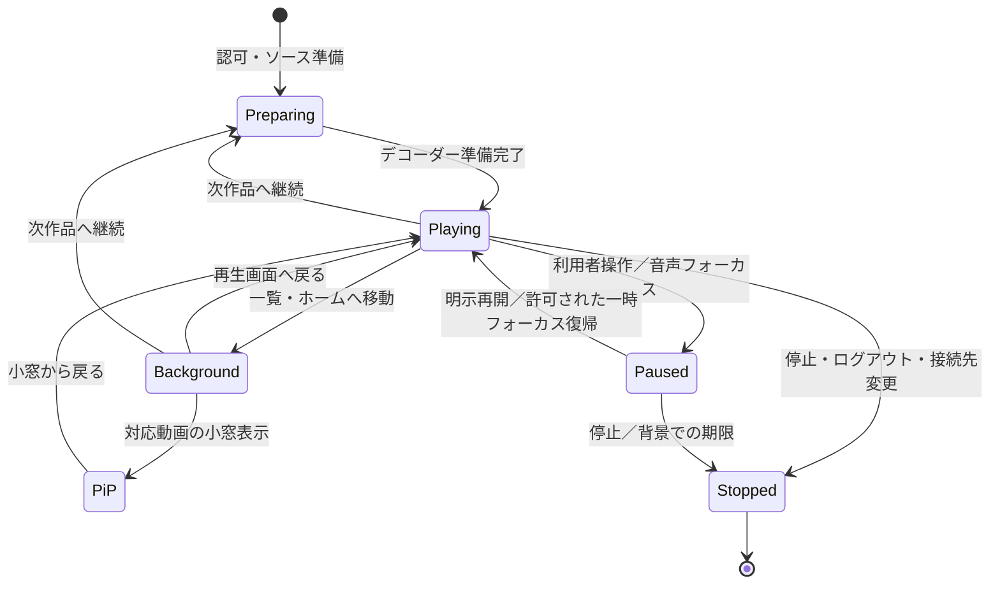

# Androidアプリとネイティブ境界

この文書は[Mirea 1.0.0](overview.md)の構造を説明します。Android versionCodeは53です。配布APKの調査には対応するGitタグの資料を使います。操作は[利用ガイド](../user/first-steps.md)、配布は[Android更新](../android-updates.md)を参照してください。

## アプリの構成

APKにはWeb UIを同梱し、Capacitorのローカルoriginで実行します。接続先のWebサイトをアプリの特権画面として丸ごと表示する構成ではありません。サーバーとはHTTPS APIで通信し、ファイル選択、長時間転送、メディア再生、生体認証、更新などを用途別プラグインに分けます。

|層／クラス|責務|生存期間|
|---|---|---|
|[MainActivity](../../android/app/src/main/java/com/suiren/mirea/MainActivity.java)|同梱UI、プラグイン登録、システムバー／キーボードのinsets、配色|アプリ画面|
|[MireaWebViewClient](../../android/app/src/main/java/com/suiren/mirea/MireaWebViewClient.java)|ナビゲーション境界、危険な汎用プロキシの遮断|WebView|
|[BundledPagePolicy](../../android/app/src/main/java/com/suiren/mirea/BundledPagePolicy.java)|APK同梱HTMLにCSPを付与、必要なbootstrapだけhash許可|同梱HTML応答|
|[MireaSessionPlugin](../../android/app/src/main/java/com/suiren/mirea/auth/MireaSessionPlugin.java)|接続先に結び付いたセッションの保護|Keystore／アプリ保存領域|
|[MireaBiometricPlugin](../../android/app/src/main/java/com/suiren/mirea/auth/MireaBiometricPlugin.java)|端末鍵の生成と、本人確認後のchallenge署名|端末鍵＋要求単位|
|[TransferService](../../android/app/src/main/java/com/suiren/mirea/transfer/TransferService.java)|選択ファイルの送信、暗号化本体の取得、通知|dataSyncフォアグラウンドサービス|
|[PlaybackService](../../android/app/src/main/java/com/suiren/mirea/playback/PlaybackService.java)|デコーダー、継続再生、音声フォーカス、通知、記録|mediaPlaybackフォアグラウンドサービス|
|[PlaybackActivity](../../android/app/src/main/java/com/suiren/mirea/playback/PlaybackActivity.java)|再生画面、向き、PiP、操作|Service状態の表示中|
|[UpdateEngine](../../android/app/src/main/java/com/suiren/mirea/update/UpdateEngine.java)|更新情報・APKの検査、取得、インストール制御|JobScheduler／利用者操作|

## WebViewの権限を外部へ渡さない

同一originかどうかはscheme・host・実効portで検査します。外部のHTTP(S)ページへのトップレベル遷移は外部ブラウザーへ渡します。不正なURL、資格情報付きURL、任意のschemeをブロックします。ローカルファイル／HTTP／contentを同梱originへ見せる汎用プロキシ経路はフレームやworker経由でも遮断します。

APK HTMLのインラインbootstrapはその実バイト列のSHA-256でCSPへ登録します。外部HTMLやダウンロードした書籍を同じ方法で信頼済みにしません。`script-src`を全体で`unsafe-inline`に緩めません。静的アプリ入口にはnative-shellの印を付け、古いPWAシェルが同梱UIへ置き換わらないようにします。

プラグインの入力も再検査します。接続先、ユーザー、対象ID、許可したパス、サイズ、期限をJava側でも確認します。JavaScript側のチェックだけをセキュリティ境界にしません。

## TLSと端末保存

[network_security_config.xml](../../android/app/src/main/res/xml/network_security_config.xml)はcleartextを禁止します。Androidのsystem CAと利用者が明示して信頼したuser CAを利用します。証明書のホスト名、有効期限、チェーン検証を省略しません。非公開CAを使う運用でも、アプリ内に特定運用者のCA秘密情報を埋め込みません。

[AndroidManifest.xml](../../android/app/src/main/AndroidManifest.xml)はアプリバックアップ／端末間データ抽出を無効にし、保存した認証状態や暗号鍵を一般的なバックアップで複製しない方針です。セッションはKeystoreのAES-GCM鍵で保護し、originとの結び付けを検証します。ダウンロード本体は暗号文のまま保存し、再生時に必要な範囲を復号します。

## 転送とファイル選択

利用者が選んだ文書のURIをSAF経由で扱います。[DocumentGrants](../../android/app/src/main/java/com/suiren/mirea/transfer/DocumentGrants.java)と転送層は、選択済みの参照を検証して読み取ります。ストレージ全体の管理権限を要求して任意のファイルを探索する方式ではありません。

転送通知はアセット単位の進行を表示します。メニューやActivityを閉じることと、転送の停止を分離します。ただしOSの強制停止、失効した文書URI、元ファイルの削除、ストレージプロバイダーの切断まで回避できません。復帰時には既存セッションと受信済みパートを照合します。手動のキャンセルはサーバーの取り込み状態も確認し、既に公開済みならアセット削除を別に確認します。

## 再生のライフサイクル

ネットワーク状態とこの状態機械は別です。online/offlineの通知だけで`Playing → Preparing`にしません。再生意図、現在位置、速度、音声フォーカス、実デコーダーの状態を区別します。先読み・画質変更で新しい閲覧イベントを開始しません。

`PlaybackJournal`は進捗と統計の再送をユーザー／接続先で分離します。トークンや内容キーはjournalのイベントへ含めません。サーバーから409の進捗競合が返った場合に無条件で上書きしません。詳細なバッファ設定と認証付きRangeは[再生設計](playback.md)を参照してください。

## 権限と公開コンポーネント

|権限／属性|必要な機能|
|---|---|
|INTERNET、ACCESS_NETWORK_STATE|HTTPS通信と復旧契機|
|FOREGROUND_SERVICE、FOREGROUND_SERVICE_DATA_SYNC、FOREGROUND_SERVICE_MEDIA_PLAYBACK|画面を離れた転送／再生|
|POST_NOTIFICATIONS|転送・再生・更新の状態通知。OSの許可状態に従う|
|WAKE_LOCK|再生や処理で必要な限定期間の継続|
|MODIFY_AUDIO_SETTINGS|音声効果・メディア音量系の操作|
|USE_BIOMETRIC|プライベート本棚の本人確認|
|REQUEST_INSTALL_PACKAGES、UPDATE_PACKAGES_WITHOUT_USER_ACTION|アプリ自身の検証済み更新。OSの条件／利用者許可に従う|
|RECEIVE_BOOT_COMPLETED|更新等のスケジュール継続に使う宣言。無認証のメディア自動再生はしない|

外部公開はランチャーのMainActivityと、OS専用権限で保護されたUpdateJobServiceに限定します。再生Activity、転送／再生Service、更新結果Receiver、FileProviderは任意の外部アプリへ公開しません。Providerから渡すURIは期限と対象の権限を限定します。

## 更新とPlay Protect

更新は固定公開鍵、package、versionCode、hash、サイズ、署名者、期限を検証します。Activity表示中／閲覧・再生・転送中などのbusy状態を考慮し、利用中に勝手に置き換えません。インストールはPackageInstallerの手順とOSの確認に従います。アプリ署名identityを変えると既存インストールへの通常更新ができなくなるため、判定回避だけを目的とした鍵の作り直しはしません。

セキュリティ製品の警告と、Mireaの更新案内の期限切れは別の事象です。非公開の判定理由を特定できたと断言しません。調査では依存ライブラリ、公開コンポーネント、WebViewの境界、ファイルアクセス、更新経路、不要な権限を確認します。自動テスト・Lint・APK解析は有効ですが、OSのインストール判定や実機のバックグラウンド制御を置き換える検証ではありません。

## テストの境界

Java単体テストとRobolectricは状態遷移、URL制約、認証復号、期限、UIの寸法と操作を再現します。JSテストは橋渡しの引数・世代管理を検証します。実機ではAPIレベル別に通知許可、ホーム移動、PiP、画面消灯、Bluetooth、プロセス破棄、通信切り替え、SAF権限、署名を維持した更新を別途確認します。検証記録には実施した方式を記し、未実施の実機試験を合格としません。
