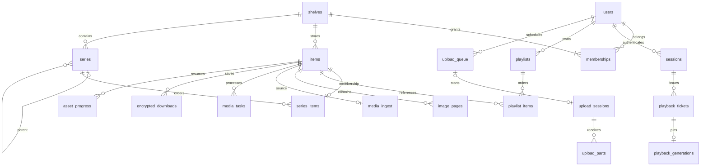

# データモデルと保存領域

[全体設計](overview.md) · [列・索引・トリガーの完全な参照](schema-reference.md)

対象は[設計書の対象版](overview.md#対象版と読み方)です。現在のDBはスキーマ25です。表の物理定義は `server/database.js` から空のインメモリDBで生成した参照表を正本とし、この文書では意味、所有者、削除、ファイルとの対応を説明します。

## DBの動作条件

[`openDatabase()`](../../server/database.js) は `foreign_keys=ON`、`journal_mode=WAL`、`busy_timeout=5000` を設定します。DBファイルは `DATA_DIR/mirea.sqlite`。SQLiteの本体だけでなくWAL/SHMと対応ファイルを同時点で扱います。

書き込み用の `transaction()` は `BEGIN IMMEDIATE`→コールバック→`COMMIT`、例外時は`ROLLBACK`です。非同期処理をコールバックへ渡して、awaitの間もトランザクションが継続すると解釈してはいけません。ファイルI/Oを済ませてから短い同期DB処理へ入る構造を維持します。

文字列IDはサーバー生成UUIDを基本とします。保存時刻は原則epoch milliseconds、再生位置はmilliseconds、動画抽出位置はsecondsです。名前に使った単位を変換せず扱わないでください。JSON列はSQLiteが全構造を検証するものではなく、各機能の入力検査・読み出しコードが構造を所有します。

## 概念ER図

これは概念図です。全FKと削除アクションは[スキーマ参照](schema-reference.md)に記載しています。例えば `analytics_views` のuser/asset/shelf IDは過去のスナップショットで、現在の親レコードへのFKではありません。

## 47テーブルの責務

| 区分 | テーブル | 保存するもの・寿命 |
| --- | --- | --- |
| DB管理 | `schema_version` | 対応する移行番号。利用者による書換対象ではない |
| アカウント | `users` | 大小文字を区別しない一意なメール、表示名、scryptハッシュ |
| アカウント | `user_access` | サーバー管理者／通常ユーザー、停止フラグ。メール名から権限を推定しない |
| アカウント | `bootstrap_accounts` | 新規管理者の初期ハッシュとの比較情報。初期資格情報の変更警告用 |
| 認証 | `sessions` | BearerのSHA-256ハッシュと失効日時。平文トークンは保存しない |
| 本棚 | `shelves` | 名前、説明、privateフラグ。本棚名の重複は許可 |
| 本棚 | `memberships` | 本棚×アカウントのowner/editor/viewer。一つの本棚につきownerは最大1件 |
| アセット | `items` | タイトル、公開形式・容量、登録者、ページ数、表紙準備状態 |
| アセット | `image_pages` | 画像本の1始まりページ番号、元画像のMIME・容量・寸法 |
| シリーズ | `series` | 本棚内の親子関係、タイトル、revision、name/manual並び順 |
| シリーズ | `series_items` | アセットの所属と位置・巻話ラベル。1アセットにつき最大1シリーズ |
| シリーズ | `series_create_requests` | 利用者×requestIdの再送を同じ作成結果へ結び付ける |
| プレイリスト | `playlists` | 個人所有のタイトル、revision、更新日時 |
| プレイリスト | `playlist_items` | 同一種類の作品への順序付き参照。原本を複製しない |
| 転送 | `upload_queue` | 送信待ちの作品ごとのメタ情報と送信セッションへの関連。ファイル本体はない |
| 転送 | `manual_upload_starts` | アカウント当たり1件の追加送信枠、要求・予約期限 |
| 転送 | `upload_sessions` | 送信ファイル配列、分割サイズ、状態、追加先、保持指定、診断、期限 |
| 転送 | `upload_parts` | 0始まりファイル／パート番号、容量、SHA-256 |
| 転送 | `transfer_hidden` | 本人が一覧から隠した完了・失敗記録。状態が変わると解除 |
| メディア | `media_ingest` | 時間メディアの不変原本、形式、容量、原本保持、正規化完了、削除状態 |
| メディア | `media_tasks` | アセット×thumbnail/transcode/previewの永続状態 |
| メディア | `video_assets` | 現在の動画世代、画質一覧、HLS情報、原本保持 |
| メディア | `audio_assets` | 正規化した音声のメタ情報、原本保持 |
| メディア | `video_generations` | 現在／旧世代の動画メタ情報。再生途中の世代を保護 |
| メディア | `video_thumbnail_state` | サムネイル抽出位置、プレビュー抽出位置・仕様版 |
| メディア | `thumbnail_overrides` | アセットとカスタム表紙原本imageIdの対応。同一原本を共有可能 |
| ナビゲーション | `video_navigation` | チャプター、字幕、場面画像、手動指定、準備状態、revision |
| 再生 | `playback_tickets` | 元セッションと1作品に限定した期限付き配信トークンのハッシュ |
| 再生 | `playback_generations` | チケットを変換世代または`source`へ固定する |
| 再開 | `asset_progress` | 本人×作品の最新位置、revision、冪等updateId、payloadハッシュ |
| 保存 | `encrypted_downloads` | 端末保存登録ID、利用者・作品、manifest、生成時刻。暗号鍵本体はない |
| 私有本棚 | `shelf_unlocks` | セッション×本棚×現パスワードハッシュに結び付いた追加許可 |
| 私有本棚 | `shelf_biometric_keys` | 利用者ごとの端末公開鍵と登録時パスワードハッシュ |
| 私有本棚 | `shelf_challenges` | 1分有効の単回チャレンジ、セッション・本棚・鍵ID |
| 管理 | `admin_jobs` | 再生成、準備、バックアップ等の受付・実行・結果 |
| 管理 | `admin_upload_retries` | 管理者による転送再処理の認可元。元利用者の権限も検査する |
| 管理 | `admin_audit` | 管理者操作の種類、対象、許可した詳細、時刻 |
| 管理 | `server_settings` | operational/processing等の保存設定JSON |
| 計時 | `job_timings` | upload/admin/mediaの実行開始・終了。進捗ETAと分離 |
| 診断 | `diagnostic_batches` | 利用者が明示送信した許可リスト方式の診断と件数 |
| 履歴表示 | `history_hidden` | 本人が履歴を隠した時刻。以後の新しい閲覧で再掲載 |
| 計測 | `analytics_views` | 閲覧単位の利用者・作品・本棚スナップショット、集計値 |
| 計測 | `analytics_events` | イベントID、seq、検証済みJSON、payloadハッシュ、受信順 |
| 計測 | `analytics_pages` | 閲覧単位×ページの滞在・訪問回数 |
| 計測 | `analytics_video_bins` | 閲覧単位×10秒区間の実時間・ソース上の進行量 |
| 計測 | `analytics_replay_bins` | 連続3秒以上という条件を満たす再生頻度用の区間 |
| 計測 | `analytics_replay_state` | 3秒条件の判定に必要な閲覧単位の途中状態 |

## 名前と階層の整合性

シリーズは `(shelf_id,parent_id,title)` が同じ新規衝突をDBトリガーで拒否します。過去版の重複を自動統合・改名しないため、単純な新規UNIQUE索引ではなくトリガーを使います。親と子は同一本棚、自己参照・祖先への循環は禁止します。子のあるシリーズを別本棚へ直接更新するのではなく、機能側が関連を保って処理します。

アセット名の同階層一意性は [`name-integrity.js`](../../server/name-integrity.js) と [`name-rules.js`](../../server/name-rules.js) の検査で扱います。作品の所属は別表にあり、送信予約も考慮するため、`items.title` の単独UNIQUEではありません。新しい書込経路も同じ検査を通してください。

順序は `position` を保存し、シリーズの `order_mode=name` では名前による順序を更新します。手動指定時は `manual`。プレイリストは個人の順序を別に持ち、シリーズの所属や順序を変更しません。旧プレイリストの異種混在を自動削除せず、編集・再生側で整合性を検査します。

## 原本と派生物の配置

| 基準領域 | 相対パス | 内容 | 再生成できるか |
| --- | --- | --- | --- |
| DATA_DIR | `mirea.sqlite` とWAL/SHM | アカウント、全メタデータ、履歴、ジョブ | 原本だけから復元できない |
| DATA_DIR | `keys/download-master.key` | 保存登録ごとの復号鍵導出元 | 既存登録を保って再生成できない |
| DATA_DIR | `storage-layout.json` | メディア領域と結び付く識別子 | 手動削除で再初期化しない |
| DATA_DIR | `thumbnails/` | 表紙派生物とカスタム表紙原本 | カスタム原本を含むため全削除不可 |
| DATA_DIR | `previews/` | 無音プレビューMP4 | 元メディアから再生成可能 |
| DATA_DIR | 管理ジョブの作業・出力領域 | 暗号化バックアップ等 | バックアップの唯一のコピーなら不可 |
| MEDIA_DIR | `uploads/<assetId>` | PDF/EPUB原本、公開用の動画・音声等 | 保持原本がない場合は唯一の本体 |
| MEDIA_DIR | `uploads/books/<assetId>/` | 画像本の元ページ、EPUB閲覧用データ | 画像ページは本体。EPUB派生だけと区別 |
| MEDIA_DIR | `uploads/transfers/<uploadId>/` | 受信済み分割 | 未送信元を選び直せない場合は重要 |
| MEDIA_DIR | `uploads/staging/<id>/` | 結合・検査・変換途中 | ジョブ状態との照合が必要 |
| MEDIA_DIR | `originals/<assetId>` | 動画・音声の保持原本 | 原本保持OFFでも安全な削除条件まで保持 |
| MEDIA_DIR | `videos/<assetId>/<generation>/` | 画質別MP4、HLS、世代 | 原本と現世代、再生チケットを照合 |
| MEDIA_DIR | `.mirea-media.json` | 分離した媒体の識別子 | DATA_DIRの識別子と組で復元 |

`MEDIA_DIR`未設定では両基準領域が同じ場所になります。設定した場合は同一ルートまたは互いに独立したルートが必要で、片方の内部にもう片方を置きません。原本と派生の詳細は [`storage.js`](../../server/storage.js)、[`custom-thumbnails.js`](../../server/custom-thumbnails.js)、[`video-publish.js`](../../server/video-publish.js) を参照してください。

## 更新と削除の境界

| 操作 | DB上の主な結果 | ファイルと他のデータ |
| --- | --- | --- |
| プレイリスト削除 | 個人リストと参照をCASCADE削除 | アセット本体、シリーズ、他人のリストは残る |
| シリーズのみ削除 | 所属を解除、子の親を再配置する機能処理 | アセットは残る。再帰削除とは別 |
| シリーズ再帰削除 | 事前プレビュー後、対象のジョブ・作品・階層を処理 | 原本・派生も削除対象。確認した範囲を再検査 |
| アセット削除 | ページ、所属、進行度、保存登録、派生メタデータ等をCASCADE | 動いている処理を止め、対象ファイルを回収。閲覧生ログは通常残る |
| 本棚共有解除 | 本人のmembershipを削除 | 作品は残る。次の認可は拒否。既取得のバイトは回収できない |
| ログアウト | 当該sessionを削除し、チケット・追加許可も失効 | サーバー原本・過去履歴は残る。端末の許可を破棄 |
| 退会 | 本人認証データを削除、共有作品のuploaded_byはNULL | 共有作品は維持。本人のanalyticsは機能側で明示削除 |
| 履歴から非表示 | `history_hidden`へ時刻を記録 | 生ログ・続き位置・メディアは削除しない |

全削除をSQLのCASCADEだけに任せてはいけません。停止すべきプロセス、ファイルの後始末、世代保護、保守ロックは [`series-actions.js`](../../server/series-actions.js)、[`shelf-management.js`](../../server/shelf-management.js)、[`admin-reset.js`](../../server/admin-reset.js) が扱います。

シリーズ削除の対象を求めるとき、公開済み作品は現在の`series_items`所属を使います。過去のアップロード先である`upload_sessions.target_series_id`は、まだ作品として公開されていない転送の対象判定にだけ使います。既に別シリーズへ移動した作品のジョブ、転送記録、保持入力を、元のシリーズ削除で消してはいけません。逆に削除対象へ移動してきた作品は、元のアップロード先が別でも対象になります。

確認用の`previewHash`を渡した削除は、作品も削除する場合・シリーズだけの場合の両方で一致を検査します。配下削除と一括操作ではhashが必須です。単体のシリーズだけを削除する旧クライアントは、hashを省略してもrevisionによる検査を受けます。対象の変更を検出したら409を返し、更新された対象を再確認します。[シリーズ削除テスト](../../tests/series-deletion.test.js)で移動済み作品の保持と古い確認内容の拒否を検証します。

## 移行と後方互換

スキーマは起動時に対応済みの旧版から更新されます。主な追加は、v14動画ナビゲーション、v15再生頻度、v16シリーズ階層、v17カスタム表紙、v18プレイリスト、v19設定・初期管理者・非表示履歴、v20表紙抽出位置、v21メディア処理と私有本棚認証、v22送信待ち、v23名前順、v24診断報告と転送非表示、v25手動送信枠です。

v23では旧シリーズを名前順へ変更する移行があります。「全ての移行は構造追加だけ」とは扱わないでください。変更前に全データ・設定を同時点で退避し、旧版へ戻すときは対応するデータも一緒に戻します。起動後には外部キー検査が走りますが、ファイル全件の完全性検査を代替しません。

設計変更時は、古いスキーマからの移行、FKとトリガー、未完了ジョブ、暗号化保存IDとマスター鍵、途中再生の世代、削除・退会時の保持境界をテストします。生成参照表の更新は `node scripts/generate-schema-docs.mjs` で行えます。
