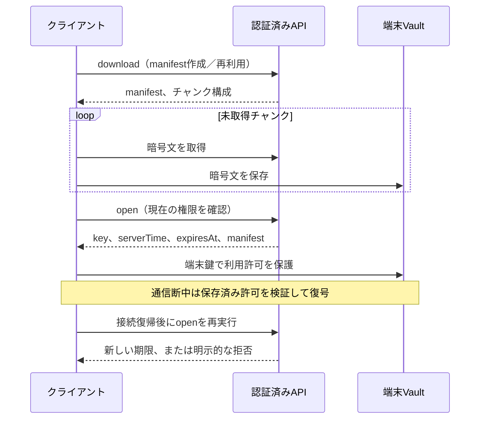

# オフライン保存・同期の設計

対象範囲は[概要](overview.md)に従います。操作手順は[ダウンロード](../user/downloads.md)、保存先の構造は[データモデル](data-model.md)を参照してください。

## 保存するものを分ける

|種類|目的|有効性と制限|
|---|---|---|
|アプリの静的画面|通信がなくてもUIを起動する|PWAのシェルキャッシュ／APK同梱ファイル。アセット本体ではない|
|カタログとサムネイル|本棚・シリーズ・タイトル・表紙を表示する|接続先とユーザー別。閲覧権限を永久に与えるものではない|
|暗号化ダウンロード|保存済みの本／動画／音声を閲覧する|本体、manifest、復号キーの利用許可がそろう必要がある|
|読書・再生の先読み|現在の閲覧を滑らかにする|一時キャッシュ。ダウンロード済みとして数えない|
|進捗・統計の送信待ち|切断中の操作を後から同期する|同じユーザー・接続先へだけ送る。再送IDを変えない|

本体を保存していないアセットもカタログへ表示できますが、通信が必要な操作は利用不可として扱います。UIの都合で毎回カタログを捨てたり、ネットワーク状態の変化だけで再生を作り直したりしません。

## カタログ同期

[library-catalog.js](../../server/library-catalog.js)は認証されたユーザーの本棚、シリーズ、アセット、進捗、プレイリスト、処理中項目を一つのDB読み取りスナップショットから返します。認可されたプライベート本棚のメタデータも含まれます。グローバル一覧での非表示と、メタデータの物理的な不在は同じ保証ではありません。

[catalog-response.js](../../server/catalog-response.js)は内容からETagを作り、`serverTime`を比較対象から外します。変更がなければ304と`X-Mirea-Server-Time`を返します。`delta=1`と既知のETagがある場合、各コレクションの追加／更新／削除／順序だけを返せます。所属、本棚のprivate属性、役割など認可範囲が変わった場合や基準がない場合は完全な応答へ戻します。差分の方が大きければ完全応答を選びます。

サーバー内の基準キャッシュは最大32 MiB／256ユーザー、10分です。これは権限をキャッシュして検査を省く仕組みではありません。要求ごとに現在の所属でスナップショットを作ります。差分は巨大ライブラリのページングを代替するものではありません。

クライアントは現在のユーザー、接続先、同期世代を確認してから結果を採用します。同じ内容なら一覧のDOMを不要に再構築しません。サムネイルや本体は別の取得単位なので、カタログの成功を全画像の取得成功として扱いません。欠落した画像は後続同期で再試行します。

## 起動と接続状態

[connection-budget.js](../../web/src/connection-budget.js)は起動時の複数読み取りに共通の予算を使います。期限内のカタログまたは保存済み作品の利用許可があり、通信なしで起動できる場合は1.2秒です。利用可能な保存情報がない場合は10秒とし、遅い正常な認証応答を短い期限だけで打ち切らないようにします。各APIごとに長いタイムアウトを直列に積み上げません。[offline-shell.js](../../web/src/offline-shell.js)は保存済みの静的ファイルを優先し、ナビゲーションのネットワーク確認は既定900 msに制限します。

通信失敗、認証拒否、権限喪失は別です。接続できない場合は期限内の保存状態から起動できますが、401/403など明示的な拒否を通信断へ置き換えて権限を継続してはいけません。接続復帰時はカタログ、保存済みメディアの許可、統計／進捗の送信を同期します。再生中のデコーダーや一覧を無条件で初期化しません。

[api.js](../../web/src/api.js)は、通信の応答だけでなく、端末のログイン情報・オフライン情報・転送済みデータを非同期で調べた後にも認証世代と接続先を再確認します。調査中にログイン、ログアウト、接続先変更が行われた場合、古い結果で新しいセッションを復元・解除・オフライン化しません。

## サーバー側の暗号化形式

[downloads.js](../../server/downloads.js)の方式はバージョン1です。

|項目|仕様|
|---|---|
|暗号|AES-256-GCM|
|平文チャンク|1 MiB、最後だけ短くなる|
|IV／認証タグ|12 byteのランダムIV／16 byteのタグ|
|送信形式|`IV || ciphertext || tag`|
|AAD|UTF-8の`mirea-download-v1\|{downloadId}\|{fileIndex}\|{partIndex}\|{plainLength}`|
|内容キー|32 byteのmasterからHKDF-SHA256で導出。saltはdownload ID、infoは`mirea-download-v1\|{userId}\|{assetId}`|
|master|`DATA_DIR/keys/download-master.key`。既存の登録があるのに欠落していれば新規生成せず失敗|
|転送制限|暗号チャンク取得は全体8、ユーザー別2。超過時429／Retry-After|

公開manifestは内部のファイルstampを含めません。サイズ、変更時刻、世代などで保存対象の同一性を検査します。タイトル変更だけなら同じ登録を再利用できますが、内容が変更された古い登録を新しい内容として開かせません。

manifestのファイル検査から登録までを、ユーザー・アセット単位で直列化します。検査中に新しい配信世代が公開されても、後から終了した古い要求が、新しい要求の登録を削除する順序にはしません。異なるユーザーやアセットの取得を一つの待機列へまとめることはありません。内容キーの導出方法や署名・認可の条件は変えません。

鍵はチャンク取得APIから返さず、別の`downloads/:id/open`で現在のアクセス権を検査した後に返します。サーバーは平文原本とmasterを所有するため、利用者だけが鍵を持つエンドツーエンド暗号化ではありません。

## 7日間の利用許可

`expiresAt = min(セッションの期限, serverTime + 7日)`です。単にネットワークへ接続した時刻ではなく、サーバーが権限を確認し利用許可を発行した時刻が基準です。ログイン保持30日とオフライン視聴7日は別の期限です。継続して接続できれば許可を自動更新します。

[offline-vault.js](../../web/src/offline-vault.js)は`origin|userId`を保存領域の区分とし、非抽出AES-GCM端末鍵で内容キー／期限／カタログを包みます。封印用AADは`sealed|{partition}|{id}`です。時刻はサーバー時刻を基準に壁時計と生存中の単調時計から評価し、1秒を超える巻き戻りは再確認を要求します。時計チェックのたびにカタログ全体を書き直さず、小さな時刻記録を更新します。

Androidは同様の期限検証を[OfflineLease.java](../../android/app/src/main/java/com/suiren/mirea/playback/OfflineLease.java)で行い、暗号文と保護した許可をネイティブ転送／再生へ引き継ぎます。端末のroot化、プロセスメモリー解析、OS時計とストレージを同時に改変する攻撃に対する完全なDRMではありません。

## オフラインでのプライベート本棚

オンラインでパスワード確認した後、端末Vault内にランダムsaltとPBKDF2-SHA256（310,000回）の確認値を保存します。オフライン時はこれを使って本人確認します。Androidで登録済みなら端末の生体認証鍵によるローカルchallenge署名を検証します。生体認証の単なる成功booleanを信用しません。

この解除は本棚の操作UIの本人確認です。本体の7日間の利用許可を延長したり、サーバーの権限変更をオフラインで即時検出したりするものではありません。登録していない端末での初回解除にはオンライン確認が必要です。詳細は[セキュリティ](security.md)を参照してください。

## 競合・削除・ログアウト

|状況|扱い|
|---|---|
|進捗の再送|同じupdateIdを再利用。revision競合409は自動で相手の進捗を上書きしない|
|統計の再送|同じevent IDと内容hashなら重複計上しない|
|保存が中断|manifestと取得済みチャンクを照合し、未取得部分から再開する|
|サーバーでアセット変更|古いmanifestを混ぜず、世代の不一致として作り直す|
|保存解除|端末の暗号文・登録を削除。サーバーの原本削除とは別|
|ログアウト|セッション・再生中の鍵・復元許可を終了。残る暗号文から勝手にログインを復元しない|
|ユーザー／接続先切り替え|別partitionへ切り替え、古い非同期応答を採用しない|

保存解除は、取得がmanifest準備中でまだ保存行を持たない場合も対象です。[downloads.js](../../web/src/downloads.js)は該当する取得を取り消し、転送とネイティブ取込が終了してから暗号文・利用許可を削除します。同じ作品の再取得は削除完了まで受け付けません。削除後に古い処理が保存行を再公開する競合を防ぎます。

[native-transfers.js](../../web/src/native-transfers.js)は、アカウント変更時に古いクライアント処理を同期的に停止し、そのpartitionのネイティブ処理と利用許可を後始末します。ハッシュ計算などの完了が遅れても、別アカウントの新しい待機処理は終了させません。同じpartitionの新しい受付は古い後始末を待ちます。ログアウトによる停止は、利用者が原本削除まで指示したキャンセルとは区別します。

ブラウザーの保存領域消去、容量不足、OSによるアプリデータ消去では保存内容が失われます。オフライン保存はサーバーバックアップの代わりではありません。

認証世代の競合は[API境界テスト](../../tests/api-context.test.js)、保存解除は[ダウンロード寿命テスト](../../tests/download-lifecycle.test.js)、転送切替は[ネイティブ転送境界テスト](../../tests/native-transfer-context.test.js)、登録世代の順序は[サーバー登録競合テスト](../../tests/download-registration-race.test.js)で検証します。
