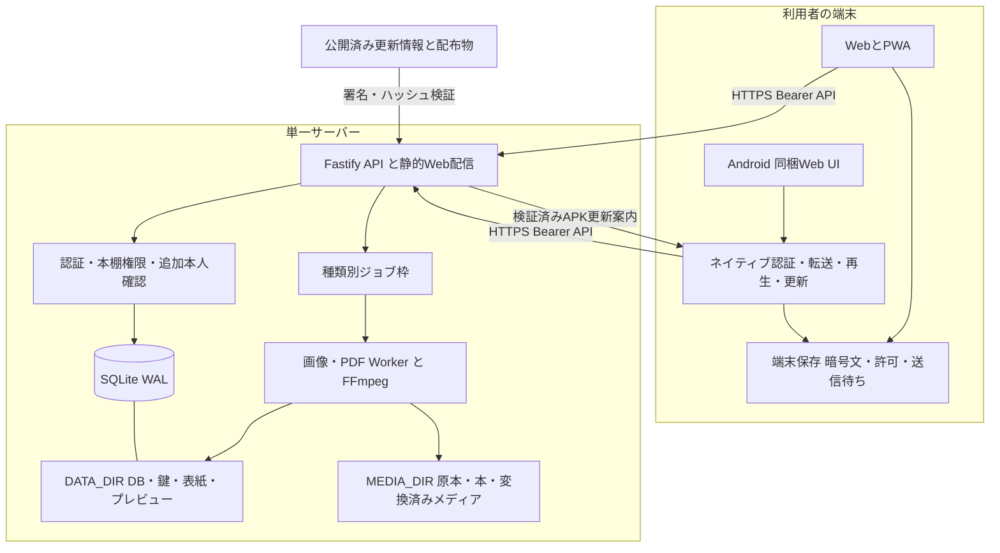

# Mirea の全体設計

[ドキュメントの入口](../README.md)

Mireaは、単一サーバーへ保存した本・動画・音声を、本棚の権限に従ってWeb、PWA、Androidから利用するメディアライブラリです。この設計書は、機能を追加・変更するときに守る境界と、関連する実装の入口を示します。

## 対象版と読み方

この文書群は **Mirea 1.0.0、DBスキーマ25** を対象にします。配布版の調査では、その配布物に対応するGitタグの資料とソースを使ってください。ブランチには公開後の変更が入る場合があるため、版番号だけでなくコミットと配布物のハッシュも照合します。[対象版と検証範囲](../status.md)

「保証」は実装上の契約を指し、OSの強制停止、任意のネットワーク品質、全メーカー端末での動作までを意味しません。実装ファイルへのリンクは作業ツリー内の参照です。設定値の正本は[設定リファレンス](../reference/configuration.md)、全ルートの入口は[API](../api.md)、実DB定義は[生成スキーマ参照](schema-reference.md)です。

| 調べたいこと | 読む設計書 |
| --- | --- |
| データがどこにあり、何を消すと何が失われるか | [データモデルと保存領域](data-model.md) |
| アップロード、並列処理、取消、再起動復旧 | [転送とジョブ](upload-jobs.md) |
| 動画・音声・本、連続再生と先読み | [再生とリーダー](playback.md) |
| PDF・画像書籍・EPUBの入力検査と閲覧データ | [書籍の取り込みとリーダー](books.md) |
| 圏外利用、保存期限、一覧・履歴・続き位置の同期 | [オフラインと同期](offline-sync.md) |
| 認証、権限、更新署名、ログ、攻撃面 | [セキュリティとプライバシー](security.md) |
| WebViewとネイティブの境界、ActivityとService | [Android](android.md) |
| なぜ現在の構成を採用したか | [設計判断と変更時の条件](decisions.md) |

## 構成と信頼境界

HTTPの入力、EPUB内容、画像・動画のバイト、端末からの計測値は信頼しません。認証済み利用者であっても、ファイル形式、寸法情報、分割ハッシュ、所有関係、進行度revisionをサーバーで検査します。プロキシの任意の転送ヘッダーを本人の権限として使いません。

Web/PWAはAPIと同一originから配信する構成です。Androidは同梱の `https://localhost` の画面から利用者が選んだHTTPSサーバーへ接続します。Androidの同梱originとAPIサーバーoriginは別です。APIサーバーのHTMLをネイティブ権限付きの同梱画面として読み込む設計ではありません。

## サーバーの起動順

1. [`server/index.js`](../../server/index.js) がインストール先基準で設定を読み、保存先・待受・TLSを決定します。TLS設定が不完全なときにHTTPへ退避しません。
2. コンテナでは通常のサーバー起動前にサンドボックスと、選択した場合の導入前検査を実行します。詳しくは[コンテナ保護](../container-security.md)。
3. [`storage.js`](../../server/storage.js) が保存先の実在、分離モード、識別ファイルを検査します。マウントが消えたときに空の別ライブラリを自動作成しません。
4. [`database.js`](../../server/database.js) がDBを開き、WAL・外部キー・移行を適用します。既知でないスキーマは拒否します。
5. 新規の空DBを通常起動した場合は [`bootstrap-admin.js`](../../server/bootstrap-admin.js) が初期管理者を作ります。既存アカウントを勝手に昇格しません。
6. [`app.js`](../../server/app.js) が認証、権限、設定、API、ジョブ、配信を組み立てます。保存済みの処理中ジョブは、各管理モジュールが再構成します。
7. HTTP受付を開始します。`/api/health` は起動・保守状態の確認用です。全メディアの存在や全ジョブの成功を保証する検査ではありません。

起動途中の失敗を「初期化し直す」ことで回避しないでください。DB、鍵、ストレージ識別子は相互に対応するため、欠けた構成を元に戻すのが復旧の基本です。

## コードの責務

| 領域 | 主な入口 | 責務 |
| --- | --- | --- |
| API組み立て | `server/app.js` | 共通エラー、認証、本棚、アセット配信、機能登録 |
| DB | `server/database.js` | スキーマ、移行、同期トランザクション |
| ライブラリ | `library-catalog.js`, `public-items.js`, `series.js`, `playlists.js` | 権限付きの一覧、階層、表示用射影、個人リスト |
| 転送 | `resumable.js`, `transfer-queue.js`, `manual-uploads.js` | 送信待ち予約、分割受信、再送、手動追加枠 |
| メディア | `media-pipeline.js`, `upload-publish.js`, `video-transcode.js`, `audio-transcode.js` | 原本準備、検証、公開、派生物生成 |
| 管理 | `admin*.js`, `processing-settings.js`, `operational-settings.js` | 管理者再認証、ジョブ、設定、バックアップ、監査 |
| 端末保存 | `server/downloads.js`, `web/src/download*.js`, `offline-vault.js` | 暗号文配信、許可、復号Range、同期 |
| Web状態 | `web/src/main.js`, `api.js`, `session-store.js`, `catalog-client.js` | アカウント・サーバー切替、API、一覧の差分適用 |
| Webプレイヤー | `viewer-shell.js`, `video-player.js`, `book-viewer.js` | プレイヤーの入れ物、再生、本の表示、操作 |
| Android | `android/app/src/main/java/com/suiren/mirea/` | OSライフサイクル、メディア、永続資格情報、SAF、自己更新 |

これらの名前はモジュールを探す入口です。例えば `app.js` の `findItem()` だけではプライベート本棚の追加本人確認を表しきれません。`private-shelves.js` の横断フックも含めて読む必要があります。

## 一貫性の方針

- **DBとファイルは同じトランザクションではない。** ファイルを一時領域で完成・検証し、公開先へ同期してからDB参照を確定します。後始末に失敗した残存ファイルは整理対象として扱い、原本を先に失わない順序を優先します。
- **権限は処理開始時だけで決めない。** 長い処理の途中・公開直前・配信の新規リクエストで再検査します。取得済みのバイトを後から回収する保証はありません。
- **再送と二重処理を分ける。** 転送パートは番号＋ハッシュ、記録はイベントID＋seq、続き位置はupdateId＋revision、シリーズ等はrevisionで整合性を保ちます。
- **画面の寿命と仕事の寿命を分ける。** ダイアログを閉じても転送を続け、サーバーが受理した後処理はブラウザーを必要としません。端末が未送信のファイルを持つ場合は、その端末の実行可能性が必要です。
- **通信失敗と認証拒否を分ける。** 接続不能時に期限内の保存データを使うことと、明示的な401・403等を無視することは別です。

## 現在の拡張範囲

単一プロセス、ローカルSQLite、ローカルファイル領域を前提にしています。複数コンテナが同じDBとキューを同時に所有する構成ではありません。`MEDIA_DIR`分離はユーザーDBとメタデータDBの分割ではなく、メディア本体を別領域に置く機能です。

ライブラリは権限付きスナップショットを構築します。作業ツリーではETag・差分応答とDOM差分適用があり、変化のない一覧を描き直さないようにしています。ただし、これは10万件の完全仮想化やサーバー側の全一覧ページングが完成したという意味ではありません。ジョブ・転送の個別ページングと混同しないでください。

外部ストレージ、複数ワーカーサーバー、新しいメディア種別を加えるときは、単なるパス置換ではなく、公開原子性、取消、ACL再検査、バックアップ、オフライン登録ID、再起動時の所有権まで設計対象になります。
