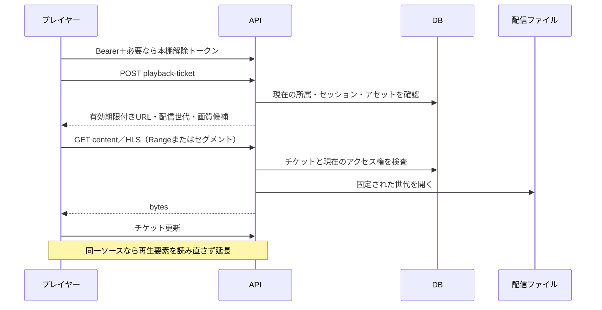

# 再生・閲覧の設計

対象範囲は[概要](overview.md)に従います。利用者の操作は[再生ガイド](../user/playback.md)、オフラインの鍵と期限は[オフライン同期](offline-sync.md)で説明します。

## 再生と表示の所有者

|機能|Web／PWA|Android|
|---|---|---|
|動画・音声のデコード|HTMLMediaElement、HLSはhls.jsまたはブラウザーのネイティブHLS|Media3 ExoPlayerを使う`AdaptivePlayback`と`PlaybackService`|
|表示|同じ再生セッションを全画面／ミニプレイヤーで共有|`PlaybackActivity`／PiPはServiceの状態を表示|
|背景再生|タブの生存とブラウザー／OSの許可に依存|mediaPlaybackフォアグラウンドサービス＋MediaSession|
|書籍|PDF／画像ページ／サニタイズしたEPUBをWebビューアーで表示|主に同じバンドル済みWeb UI|
|進捗・統計|ユーザー・接続先で分離した再送処理|Serviceが記録し、端末内journalから再送|

画面を閉じる／回転する／一覧へ戻ることと、メディアを停止・破棄することを分けます。再生要素を不要に作り直すと、短い無音、再生位置のリセット、二重計測、PiPの終了が発生するためです。アカウント変更、接続先変更、明示停止は再生の所有権を終了させます。

## 認可と再生チケット

URLに任意の`ticket`パラメーターがあるだけでは認可を省略しません。アセット、ユーザー、セッション、有効期限、公開世代を検査します。チケットURLは秘密情報として扱い、公開ログや診断コピーへ含めません。[playback-source.js](../../server/playback-source.js)は旧チケットの世代を固定し、再生成で別のサイズ／内容にすり替わることを防ぎます。

音声・動画は受信後に原本が公開されると、正規化の完了を待たず再生できます。端末が原本のコンテナ／コーデックを再生できる必要があります。正規化が未完のアセットの暗号化ダウンロードは待機させます。「原本がある」と「どの端末でもデコード可能」は同義ではありません。

## Webのストリーミングと復旧

[video-stream.js](../../web/src/video-stream.js)はHLS対応ならHLS、非対応ならMP4を選びます。

|状態|動作|
|---|---|
|通常のHLS再生|先読み目標90秒、最大180秒、最大64 MiB、後方10秒。メモリーと時間の上限は両方適用される|
|次作品の先読み|目標20秒、最大30秒、最大16 MiB。消音した再生しない要素を一つだけ保持|
|自動画質|帯域推定による切り替え。「データ節約」は短辺480以下へ上限を設ける|
|固定画質|対応するレベルを固定。不一致時に自動画質へ黙って変更せず、エラーを返す|
|一時的な通信失敗|1秒から指数的に延長し最大30秒で再試行。onlineイベントも再試行契機にする|
|400/401/403/404/410/422/423|通信断とは区別し、無期限の自動再試行をしない|
|メディア復旧|hls.jsのrecoverMediaErrorを15秒以上間隔で試す。復旧不能時は操作可能なエラー表示|
|チケット更新|期限の約60秒前。URLが同じなら読み直さない。必要な交換では位置・速度・再生意図を復元|

これは設定上の上限／目標です。帯域不足、ブラウザーのメモリー回収、停止中のタブ、ネイティブHLSの実装によって実際のバッファ量は異なります。ネットワークが切り替わっただけで再生ソースを交換しません。既にあるバッファを使い、実際に取得が必要になった地点で復旧します。

ブラウザー標準のHLS・MP4・音声でも、メディア要素のネットワークエラーは再試行対象です。復旧時は位置・速度・利用者の再生／一時停止の意図を復元します。形式・デコードの失敗は通信断と同一視せず、認可の拒否が確認された場合も自動復旧を止めます。

## Androidの配信境界

主実装は[AdaptivePlayback.java](../../android/app/src/main/java/com/suiren/mirea/playback/AdaptivePlayback.java)、[PlaybackService.java](../../android/app/src/main/java/com/suiren/mirea/playback/PlaybackService.java)です。

ExoPlayerのロード制御は、通常60～180秒、初回開始750 ms、再バッファ後1.5秒、後方10秒を基準とします。バイト上限は端末ヒープに応じ8～64 MiBへ制限します。これらの大きい先読み目標を満たすまで初回開始を待たせる設計ではありません。

ネットワークDataSourceは同じHTTPS origin、許可したアセットの配信パス、既知のHLSファイル名に限定します。リダイレクトは拒否します。Range応答のステータス・Content-Range・長さを検証し、manifestは1 MiB、セグメントは32 MiBを上限とします。暗号化保存データは必要なチャンクだけ認証復号し、平文メディアを永続ディスクへ書きません。

Serviceは音声フォーカス、イヤホン取り外し、通知操作、画面状態を管理します。背景のActivity破棄で所有中のプレイヤーを破棄しない一方、OSの強制停止、端末再起動、メーカー独自の省電力機構を回避する保証はありません。通知や電池最適化のために広範な権限を追加する設計ではありません。

固定MP4とHLSの切り替えでは、現在位置と再生意図を引き継いでソースを開き直します。同じHLS内の画質変更はデコーダーを維持します。通知・画面の表紙はアセットIDで区切り、次作品に画像がなければ前作品の画像を残しません。埋め込み画像や、現在のアカウント・アセットに対応する有効な暗号化保存データの表紙を利用します。

PiPは動画用の`PlaybackActivity`だけが担当します。明示的なPiP要求とAndroid 15以降の移行開始通知では、操作UI・ダイアログを先に隠し、移行中の画面方向変更を抑えます。ライブラリへの復帰はPiPモード確定後に行い、開始要求の受理だけでライブラリを前面に出しません。移行が成立しなければ操作UIを復元します。Serviceが終了した場合や音声へ切り替わった場合は空のPiP画面を残しません。

## 連続再生・先読み・順序

シリーズとプレイリストの順序を解決し、現在のアセットと再生種類から次候補を求めます。通常再生、単体リピート、シリーズ／プレイリストリピート、シャッフルは別の状態です。手動の次／前と自然終了を混同せず、自然終了の重複通知で二つ先へ進めません。

音声・動画のプレイヤー内の作品切り替えは保存位置によらず0から開始します。一覧からの直接起動は従来のレジュームを使い、書籍の手動選択も保存ページを維持します。先頭開始は表示上の選択であり、未解決の進捗競合や再送中の記録を勝手に破棄しません。Androidで先読み候補を採用したら消費済みの次候補計画を破棄し、次の作品の計画を作り直します。先読みの認可待ち中の一時停止・シーク・新しい選択は、その遅延した採用を取り消します。

[media-preload.js](../../web/src/media-preload.js)は次候補一つのチケットを3秒以内で取得し、最長5分の一時的な先読みとして保持します。採用時に現在のアカウント・接続先・候補を再確認します。先読みは閲覧、再生時間、進捗更新として数えません。未取得・期限切れ・権限変更時は通常の取得へ戻ります。別作品のデコード開始までを完全に無音ゼロにするギャップレス再生の保証ではありません。

Webの次作品は未確定の候補として準備し、その間は現在作品とOSのメディア操作を維持します。キャンセル・アカウント変更・候補の失効を確認してから切り替え、シャッフルの次候補もその時点で確定します。未確定候補の失効によって現在のプレイヤーまで閉じません。

ブラウザーPiPは元の接続済み動画要素に属するため、次作品へ移る際もその要素を引き継ぎます。古い操作部品は解除し、PiP終了後に動画を現在の表示領域へ戻します。新しいソースのメタデータが届くまでは旧作品の位置を新作品の進捗として保存しません。画面の表示だけでなく、ソース・進捗・OS操作の所有者を同じ切替境界で更新します。

## 書籍のページ取得

[image-page-cache.js](../../web/src/image-page-cache.js)は現在の読書セッション専用です。

- ページ読み込みは最大4並列。背景先読みには全枠を与えず、表示ページ用の枠を残します。
- 現在位置に近いページから全体を先読みします。表示要求は待機列の前へ移動します。
- メモリーLRUは既定64 MiB。大きいページを無制限に保持しません。
- IndexedDBへ置く一時ページはAES-GCMで暗号化し、非抽出鍵はその読書セッションだけが所有します。通常のオフライン保存とは別です。
- ストレージ書き込み不可・容量不足ではメモリー中心に縮退し、閲覧を継続します。読み終わりに消去し、クラッシュ残骸は1日後の掃除対象になります。
- 次の画像書籍の先読みは最初の1ページ、既定16 MiBまでです。閲覧数を記録しません。

原本ページと表示用ページは分けます。[page-display.js](../../server/page-display.js)の表示用画像を優先し、拡大や原本取得との責務を区別します。全ページの展開後ビットマップをRAMへ固定する仕組みではありません。大きい書籍でもメモリー上限を守るため、読み返すと再取得する場合があります。

## 続き位置・統計・再生設定

`asset_progress`はユーザー／アセット単位のrevisionを持ちます。書き込みには`revision`と`updateId`が必要です。同じ更新ID・同じ内容は再送成功、異なる内容や古いrevisionは409です。通信断で別端末の新しい位置を無条件に上書きしません。

時間位置はミリ秒、ページは1始まりです。先読み、シーク中、バッファ待ちを視聴時間へ加算しません。リピートなどの操作・音量・画質・イコライザー設定は進捗とは別に管理します。匿名の再生頻度グラフは[再生頻度](../video-replay.md)、統計の権限は[統計設計](../analytics.md)を参照してください。

## UIとアクセシビリティの責務

オーバーレイ操作はメディアのレイアウトを押し下げず、固定を選んだ場合だけ領域を確保します。アイコンにはアクセシブルな名前を付けます。シーク中・メニュー操作中・一時停止中などに操作を勝手に隠しません。低減モーション設定では背景効果を弱めます。これらの表示変更で再生セッションや統計のIDを作り直さないことが実装上の不変条件です。
