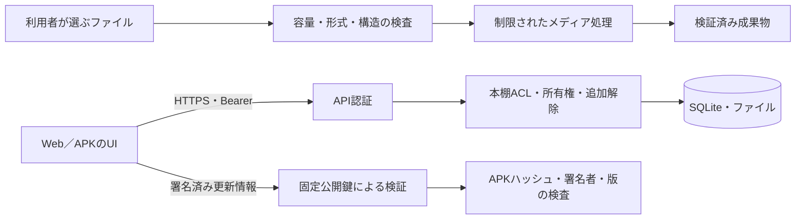

# セキュリティ・認可の設計

対象は[概要](overview.md)の作業ツリーです。脆弱性の報告先は[SECURITY.md](../../SECURITY.md)、運用手順は[ドキュメント索引](../README.md)を参照してください。

## 信頼境界

クライアント、入力ファイル、ファイル名、HTTPヘッダー、保存済みmanifestを信頼済みとは扱いません。一方、サーバーOSの管理者はDB・平文アセット・サーバー鍵を読める権限を持ちます。プライベート本棚や匿名集計は、サーバー管理者からデータを暗号的に隠す機能ではありません。

## 認証とセッション

[security.js](../../server/security.js)はランダム16 byteのsaltとscryptによる64 byteのパスワード導出値を保存します。トークンは32 byteの暗号乱数をbase64url化した43文字で、DBにはSHA-256だけを保存します。APIは`Authorization: Bearer ...`を認証し、有効期限とユーザーの有効状態を確認します。

通常のセッション期限は30日です。Webの「ログインを保持」は`__Secure-mirea_session`（Secure、HttpOnly、SameSite=Strict、Path=/api/v1、Domainなし）を使い、明示したremember APIでBearerを復元します。一般の更新APIをCookieだけで認証する設計ではありません。AndroidはKeystoreで保護した保存を用います。

パスワード／メール変更、ログアウト、ユーザー無効化、セッション期限を考慮します。画面側ではアカウントや接続先が変わった後に古い要求が成功しても、その結果を現在のセッションへ採用しません。開発ログやリリース成果物にトークンを保存しないことも、この境界の一部です。

初期管理者は空のDBでのみ準備します。既定認証情報は初回セットアップ用であり、変更を要求する状態を`bootstrap_accounts`で管理します。通常運用のパスワードとして文書へ埋め込んだり、既存DBへ再作成したりしません。

## 認可の単位

|単位|主要な条件|
|---|---|
|本棚の閲覧|現在のmembershipsに所属する|
|追加・編集|ownerまたはeditor。個別操作は所有者／管理者条件も確認する|
|本棚管理|owner、または明示したサーバー管理APIの管理者権限|
|アセットの表紙再生成|アップロード者本人、または本棚所有者などの条件と、現在の本棚権限を確認。管理者用の再生成APIは別にある|
|プレイリスト|本人所有。参照アセットは現在も閲覧可能で、同じ種類である|
|進捗・履歴・転送|本人の記録。対象アセット／本棚の現在の認可も確認する|
|バックアップ・設定・ジョブ管理|有効なサーバー管理者。初期設定の完了条件も適用する|

存在を隠すため、所属しない本棚やアセットは404になる操作があります。「認証済みだからUUIDを指定すれば読める」というAPIではありません。長時間ジョブは受付時だけでなく実行時・公開直前にも権限を確認します。

## プライベート本棚の追加解除

[private-shelves.js](../../server/private-shelves.js)では、通常のログインに加え、本棚・セッション・現在のパスワードhashに結び付いた解除トークンを要求します。最大期限は24時間またはセッション期限の短い方です。`X-Mirea-Shelf-Unlock`は最大20件のトークンを渡せます。

- Web／PWAはMireaパスワードで確認します。
- Androidは最初にパスワード確認して端末公開鍵を登録します。鍵はP-256、ユーザーごと最大20件です。
- オンラインの生体認証は60秒の単回challengeへ署名し、サーバーが登録公開鍵でECDSA-SHA256を検証します。challengeは不正な署名の試行でも再利用しません。
- パスワードが変われば、過去のパスワードhashに結び付いた解除や登録を無効にします。
- パスワード／生体認証の試行はユーザーごと毎分10回へ制限します。

一覧から隠す処理だけに依存せず、メディア、ダウンロード、編集、シリーズ、一括操作などのAPIも検査します。有効なスコープ付き再生チケットはコンテンツ要求に使用できます。オフラインの本人確認は[オフライン同期](offline-sync.md)にある別の許可検証と組み合わせます。

保護対象の特定には、Fastifyが一致させたルート定義とデコード済みのパラメーターを使います。生のURL文字列だけから本棚IDやアセットIDを取り出さないため、同じIDのパーセント符号化でも解除条件は変わりません。`GET /items/:id/series`のシリーズ情報も追加解除の対象です。再生チケットを使えるのは既存のcontent・HLS・rendition配信経路だけであり、`ticket`というクエリがあるだけで他のAPIの解除を省きません。[回帰テスト](../../tests/pipeline-0200.test.js)では符号化したID、シリーズ情報、正常な配信チケットを確認します。

## 入力メディア・ファイルシステム

拡張子だけで形式を信頼せず、宣言MIME、magic、デコーダー、出力構造を検査します。画像書籍の1枚は100 MiB、ページ数や総アップロード量にも制限があります。画像書籍のページは画素数だけで一律に拒否しません。EPUB内の画像や埋め込みジャケットには別の制限があります。圧縮サイズが小さくても展開時に大きなメモリーを要求する入力はあり、ワーカーの時間・資源制限とOSの容量管理が必要です。

パスは利用者のファイル名をそのまま保存先として使わず、管理下のIDで組み立てます。data/mediaのルートと保存先識別子を検査し、意図しない空ディレクトリへのDB新規生成や、リンクを使った別領域の参照を防ぎます。原本やcustom表紙は再生成の入力として保持し、成果物を検証後に公開します。

コンテナの初期検査やOSの制限は[運用ドキュメント](../README.md)を参照してください。非root、最小の書き込み領域、必要な一時領域を用意します。エラー回避のために特権モード、広い権限、TLS検証無効化へ変更しません。

## ブラウザーとネイティブ橋渡し

WebサービスはCSP、nosniff、同一origin中心のコンテンツ読み込み、限定したCORSを設定します。EPUBのHTMLはサニタイズし、書籍内のコードをアプリ権限で実行しません。

AndroidはAPKに含めたUIだけをネイティブプラグインへ接続します。別のWebサイトを同じ特権WebViewに読み込まず、外部リンクは通常のブラウザーへ渡します。汎用のCapacitor HTTP／file／contentプロキシ経路をブロックし、ユーザーが選んだファイルはSAFと目的別の転送APIで扱います。詳細は[Android設計](android.md)を参照してください。

## 更新の二重検証

更新案内の署名とAPK自体の署名は別です。

1. 固定公開鍵で、更新JSONのECDSA P-256署名と構造を検証します。
2. packageName、versionCode、minSdk、発行時刻、最長7日の有効期限、HTTPS URLを検証します。
3. 取得したAPKのサイズ、SHA-256、署名者証明書のSHA-256、パッケージ／版を検証します。
4. OSのインストーラーへ渡します。署名不一致や古い版へ黙って置き換えません。

更新情報の再署名はAPKを再署名する操作ではなく、期限切れの案内を同じAPKについて更新する保守です。APK署名identity、更新情報署名鍵、TLS鍵、ダウンロードmaster、端末鍵は用途が異なるため流用しません。公開リポジトリやCIへ秘密鍵を移す必要はありません。

## 診断・匿名統計

安全な診断は許可リストから新しいオブジェクトを組み立てます。例外原文を正規表現で消すだけではありません。一般ユーザーには作品名、メール、ユーザー／作品ID、絶対パス、SQL、URL、トークン、デコーダー出力を返しません。通常のサーバーログにはより詳細な原因が残る場合があるため、公開共有の前には別の確認が必要です。

匿名統計は当日を除外し、5人以上の集団を対象に丸めます。詳細な本人履歴やOS管理者のDBアクセスとは別の公開境界です。差分攻撃まで数学的に保証する差分プライバシーではありません。[診断](../error-diagnostics.md)と[統計](../analytics.md)に保持・送信の詳細があります。

## 保証しないこと

OS管理者・root化した端末からの秘匿、無期限オフライン認可、ネットワーク断中の即時権限失効、あらゆるメディア入力への無制限資源、ブラウザー／OSの強制停止後の再生継続は保証しません。セキュリティ製品の判定理由が非公開の場合、コードの修正だけで判定解除を保証することもできません。機能と権限の必要性を文書化し、検証可能な境界を維持します。
