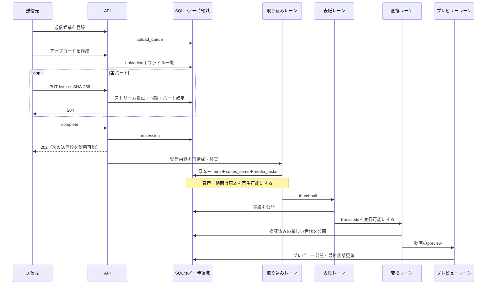
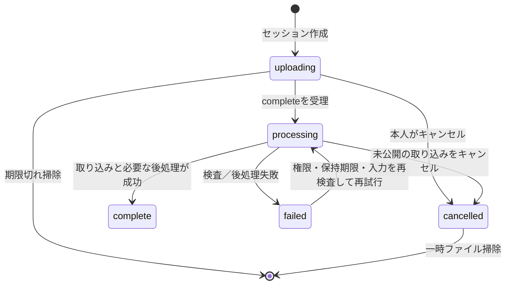

# アップロードと後処理の設計

対象は[設計書の適用範囲](overview.md)に記した作業ツリーです。利用手順は[アップロード](../user/uploads.md)、APIの形式は[API](../api.md)、永続状態の列定義は[データ辞書](schema-reference.md)を参照してください。

## 三つの待機列

「端末にあるファイルを送る」「受信済みのファイルをアセットとして公開する」「派生メディアを作る」は別の仕事です。

|層|永続情報|実行主体|終了の意味|
|---|---|---|---|
|送信候補|サーバーの`upload_queue`と、送信元端末のファイル参照|Webの転送管理／Android TransferService|送信開始要求が受け付けられる|
|分割アップロード|`upload_sessions`、`upload_parts`、一時ファイル|送信元＋`resumable.js`|全パートを受け付けて`processing`になる|
|取り込み・派生生成|`media_ingest`、`media_tasks`、`admin_jobs`|サーバーのジョブプール|原本公開、表紙、正規化、プレビューがそれぞれ完了する|

別端末に見える送信候補にはファイル本体はありません。別端末から強制開始を要求しても、ファイルを持つ端末が稼働しなければ送信は始まりません。ブラウザーを閉じてもサーバーで継続できるのは、必要なファイルを受信した後の処理です。

## 通常の取り込み

`processing`の開始で通常の送信枠を解放します。`complete` APIの202は変換成功ではありません。画像書籍・PDF・EPUBでは、ページ／内容の検証と公開を取り込みレーンで行い、音声・動画のような原本先行再生とは異なります。

## 分割プロトコルと再送

[resumable.js](../../server/resumable.js)は既定8 MiBのパートを受け取ります。設定可能範囲は64 KiB～16 MiBです。クライアントは作成応答の`chunkSize`に従い、推測した固定値を使用しません。

1. セッション作成時にタイトル、保存先、シリーズ、ファイル名・MIME・長さ、原本保持方針を固定します。所属と編集権限、同階層の名前、アップロード枠を検査します。
2. PUTは受信ストリームの長さとSHA-256を検証し、排他的な一時ファイルへ書きます。`fsync`、rename、ディレクトリ同期の後にパート記録を確定します。
3. 同じ番号・ハッシュ・長さの再送は204で成功します。異なる内容による置き換えは409です。不正な長さ／ハッシュは422です。
4. `complete`はパートの充足を確認します。再構成時にも各パートのハッシュを再検証します。
5. 完了とキャンセルはアップロード単位で排他制御し、書き込み途中のパートと競合させません。

HTTP要求の成功だけを信用してローカルファイルを破棄せず、セッション状態を確認してください。`resume:true`では同じユーザー・保存先・シリーズ・タイトル・ファイル構成・原本保持方針の一致を検査します。複数の候補が一致する場合は409で止めます。

送信セッションは通常24時間、失敗した書籍の再試行用データは7日間保持します。処理中／使用中のデータは期限掃除と競合させません。失敗した音声・動画の取り込み情報は原本による再生成のため別途保持します。これは永久保存の保証ではなく、削除操作やアセット削除の対象です。

## 状態遷移

公開済みの原本がある後処理失敗では、アップロードが`failed`でもアセットは利用できる場合があります。「失敗」を「アセットが存在しない」と解釈してはいけません。既に公開済み／完了済みのアップロードをDELETEすると409になり、利用者がアセット削除を明示して確認する必要があります。

`media_tasks`は`queued → running → complete / failed / cancelled`です。再試行では対象を再び`queued`にします。管理者ジョブは`queued → running → complete / failed`で、キャンセル扱いの詳細は各操作の結果に含めます。クライアントで転送行を非表示にすることは、サーバーのファイル削除やジョブキャンセルではありません。

## 並列処理と依存関係

[job-pool.js](../../server/job-pool.js)のレーンは独立しています。既定値は次のとおりです。管理画面の設定と環境変数による上書きは[設定リファレンス](../reference/configuration.md)を参照してください。

|レーン|既定の同時数|用途|
|---|---:|---|
|ingest|2|受信データ再構成、書籍の検証・公開|
|thumbnail|2|表紙生成・再生成|
|transcode|5|動画・音声の正規化と配信データ作成|
|preview|1|動画プレビュー|
|other|1|その他の管理処理|

同じアセットでは表紙の処理終了後に変換を開始します。表紙が失敗しても変換できる場合は変換を続けます。プレビューは変換成功を待ち、変換が失敗／中止したときは待ち続けず失敗として確定します。異なるアセットの表紙・変換・プレビューは同時に進みます。

各プールはキー付きFIFO、実行中数、待機数、AbortControllerを管理します。完了／失敗のどちらでも枠を返し、次の仕事を起動します。転送優先通知は変換・プレビューの**新規開始**を短時間遅らせるもので、実行中のエンコーダーを強制中断しません。CPUやI/Oの使用率を必ず100%にする保証はありません。ストレージ、エンコーダー、並列レーンの合計、メモリー制限が実効速度を決めます。

### 手動で開始する追加枠

- 送信：ユーザーごとに通常上限とは別の1枠。`manual_upload_starts`で共有し、未開始の要求は90秒で失効します。別端末からも要求できますが、元端末にファイルが必要です。
- ジョブ：管理者ごとに全レーンを通じた1枠。実行可能な待機ジョブが対象です。依存関係や権限、入力検査は省略しません。
- 後者の追加枠自体はプロセス内状態です。再起動後は永続ジョブを通常の復旧処理で拾います。「強制開始だから依存を無視する」「永遠に上限を増やす」という仕様ではありません。

## 再起動・キャンセル・権限変更

|出来事|復旧／停止の単位|
|---|---|
|ブラウザー更新・終了|送信前のFile参照は自動復元できないことがある。受信済みの後処理はサーバーで継続する|
|サーバー再起動|永続`processing`セッションを再スケジュールし、`running`メディアタスクを`queued`に戻して再開する|
|プロセスの正常終了|新規開始を止め、実行中の子処理をAbortし、再開可能な永続状態を残す|
|権限剥奪／ユーザー無効化|実行前・公開前に現在のユーザー／本棚権限を再確認して停止する|
|管理者による再生成|要求者が現在も有効な管理者であることを確認する|
|アセット削除|関連ジョブを停止し、派生データ・原本・参照を削除する。DBとファイルの境界は[データモデル](data-model.md)参照|

中断したFFmpegをCPU命令の途中から再開する仕組みではありません。再利用可能な受信パートや確定済み成果物を使い、未完の処理単位をやり直します。

## 成果物の公開と原本保持

[media-pipeline.js](../../server/media-pipeline.js)、[video-publish.js](../../server/video-publish.js)、[canonical-publish.js](../../server/canonical-publish.js)は、未完成ファイルを配信パスに直接上書きしません。候補を作成・検査・同期し、新しい世代を配置してからDBの公開情報を切り替えます。再生チケットが使用中の旧世代はそのチケットに結び付けます。

原本保持を無効にした場合も、正規化完了、必要なタスクの完了、原本世代を使う有効な再生チケットがないことを確認してから原本を回収します。回収は定期処理でも行われます。失敗時に「保持しない」を理由に唯一の入力を先に削除しません。

カスタム表紙は`thumbnail_overrides`と保持したアップロード画像を優先します。再生成はこの原本からWebPを作り直します。自動表紙の生成中にカスタム表紙へ変更された場合も、公開前に再確認して上書きを防ぎます。

## 監視で見る情報

現在の仕事、失敗履歴、送信待ちは別に数えます。`job_timings`に開始・終了を記録し、経過時間と推定残り時間を表示します。推定時刻は実測速度／履歴からの目安で、予約された完了時刻ではありません。`media-failure.js`は容量不足・権限・破損を分類し、安全な詳細を転送記録へ保存します。原文のデコーダーログを一般ユーザーへ返さない設計は[診断](../error-diagnostics.md)を参照してください。
