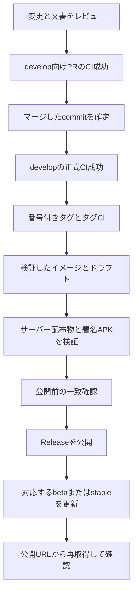

# リリースと更新情報の保守

この手順は配布担当者向けです。公開するコミットと成果物を確定し、利用者が同じ署名・同じデータを保って更新できることを確認します。通常の開発や文書編集だけでは実行しません。

## 版の対応

| 対象 | ベータ版の形式 | 正式版の形式 |
| --- | --- | --- |
| package.json | `X.Y.Z-beta` | `X.Y.Z` |
| Android versionName | `X.Y.Zbeta` | `X.Y.Z` |
| Android versionCode | 前回より大きい整数 | 同左 |
| Gitタグ | `vX.Y.Zbeta` | `vX.Y.Z` |
| 固定イメージタグ | `X.Y.Zbeta` | `X.Y.Z` |
| 追従イメージタグ | `beta` | `stable` |
| DBスキーマ | DB構造変更に対応する独立の整数 | アプリ版と別に管理 |

機能追加はminor、不具合修正はpatchを基本にします。互換性を壊す変更は移行方針を先に決めます。番号付きGitタグ・公開APK・固定イメージを同じ番号の別内容へ差し替えません。

1.0.0の対応は、package／Android versionNameが`1.0.0`、versionCodeが53、Gitタグが`v1.0.0`、固定イメージが`1.0.0`、追従先が`stable`、DBスキーマが25です。0.xのAPK更新JSONの定期再署名は1.0.0の公開日時以降は行いません。既存成果物を残し、`beta`利用者へ明示的なチャネル変更とサーバー→APKの更新順を案内します。

## 公開までの順番



CI成功はGitHubのrunが `completed/success` で、対象commitと一致することを意味します。途中のビルド成功ログで代用しません。

## 1 公開対象を固定する

- 作業ツリーに未反映の差分がないことを確認します。
- package、lock、Android、Compose、Docker labels、文書、変更履歴の版を揃えます。
- DB移行があれば、全バックアップからの復元と旧版への切り戻し条件を記載します。
- 実施した自動テスト・画面確認・実機確認を分けます。
- 公開文書、ソース、PR本文、スクリーンショット、配布物に個人の環境情報がないか確認します。

### 既存利用者の更新を受け入れ確認する

初回導入と同じ候補の再起動だけで公開を判断しません。[旧版からの更新・復元試験](testing.md#公開旧版からの更新と復元)に加え、実際の配布形式を使い、公開旧版から候補へ更新してアカウント・進捗・履歴・暗号化ダウンロードが保持されることを確認します。データを初期化した成功は更新の成功として扱いません。問題があれば、更新前の完全バックアップを別の空の場所へ復元して旧版で開けることを確かめます。

APKは公開旧版と同じ署名で上書きし、保存済み作品を再取得せず利用できること、PiP・バックグラウンド・回線切替を実端末で確認します。ソース結合テスト、Robolectric、未署名APKビルドは実端末での受入結果と分けて記録します。

1.0.0ではAndroid 17実端末によるこの受入確認は未実施です。公開判断で実機確認を延期した場合も、単体テストやビルドで代替済みとは記載せず、未確認のPiP・省電力・回線切替とPlay Protect再判定をリリースノートに残します。

メジャー更新時は、[正式版への移行手順](../operations/updates.md#ベータ版から正式版へ移るとき)と旧メジャーのAPK更新情報の保守終了日をリリースノートに含めます。`beta`利用者が自動で`stable`へ移るとは案内しません。更新案内に必要な既存の署名鍵、公開JSONの期限、対応するAPKが利用できることを公開前に確認します。

第三者ライセンス表示を含むビルド済み画面をAPKへ同期し、最終APK・Web・サーバーアーカイブに依存物の必要なLICENSE/NOTICEが含まれることも検査します。ビルド前のソースにライセンスがあるだけでは、配布物への同梱確認にはなりません。

## 2 CIとコンテナ

[verify.yml](../../.github/workflows/verify.yml)はWeb/API、Web UI、コンテナ、Androidを検証します。番号タグの実行では、コンテナjobで検証したイメージを保存し、公開jobが同じイメージを読み込んで検証します。

[公開ポリシー](../../scripts/container-channel-policy.mjs)はrepo、version、tag、commit、digest、CIの成功を照合します。公開Releaseの種別とタグが合う場合だけ対応チャネルを進めます。最初の正式版が公開される前に `stable` が存在するとは案内しません。`latest` を代用しません。

フォークでは[独自配布](fork.md)の信頼先変更が必要です。検証を削って公式向けスクリプトを通す方法は使いません。

## 3 サーバーアーカイブ

対象commitのチェックアウトで依存を導入し、Webをビルドします。

```sh
pnpm install --frozen-lockfile
pnpm build
pnpm test:package
```

`scripts/package-server.mjs` に対象commitの完全な40桁SHAを渡します。

```sh
node scripts/package-server.mjs --commit=REPLACE_WITH_FULL_COMMIT_SHA
```

`REPLACE_WITH_FULL_COMMIT_SHA` は説明用です。`git rev-parse HEAD` の結果を確認して置換します。公開前に作業ツリーがそのcommitと一致することを確認します。スクリプト自身は未コミット差分の不在を保証しません。

出力は `releases/mirea-<版>-server.tar.gz` とSHA-256ファイルです。固定allowlistのソース・dist・docs・scripts等を収録します。allowlist配下に機密ファイルを置けば混入し得るため、許可ディレクトリだから安全と判断せず内容を検査します。同じ出力名があれば上書きせず停止します。

## 4 Androidの署名と更新JSON

1. `pnpm android:sync` を実行します。
2. 配布秘密鍵をCIへ渡さず、署名用端末でrelease APKを作成します。
3. apksignerで署名者、aapt2でpackage・版・minSdk・debuggableを確認します。
4. [sign-android-update.mjs](../../scripts/sign-android-update.mjs)でAPKの構造、サイズ、ハッシュ、公開鍵pin、署名者を検証してJSONを生成します。
5. APKの公開URLを確定して署名します。後からJSONのURLだけを書き換えません。
6. APKを先に配置し、そのAPKを指すJSONを後に配置します。

### 配布署名付きAPKを作る

JDK 21とAndroid SDK platform 36 / build-tools 36.0.0を準備します。[開発環境](setup.md)のセットアップが前提です。既存アプリを更新する公式配布では、同じAPK署名鍵を使います。新しい鍵の作成は独自配布を始める場合だけで、既存ユーザーの更新対策として行いません。

署名プロパティはリポジトリ外の保護された場所に置きます。次は項目名を示す例であり、山括弧の値は配布担当者の保管情報に置き換えます。秘密値をコマンド引数やCI設定へ書きません。

```properties
storeFile=/secure/mirea-signing/release.p12
storeType=PKCS12
storePassword=<保管しているパスワード>
keyAlias=<既存の配布鍵エイリアス>
keyPassword=<保管している鍵パスワード>
```

Windowsのパスは `C:/Secure/MireaSigning/release.p12` のように指定します。リポジトリのルートで同期した後、Androidフォルダーでビルドします。

```sh
pnpm android:sync
cd android
./gradlew testDebugUnitTest lintDebug assembleRelease -PmireaSigningPropertiesFile=/secure/mirea-signing/signing.properties
cd ..
```

PowerShellでは `./gradlew` を `.\gradlew.bat` に置き換えます。署名された出力は `android/app/build/outputs/apk/release/app-release.apk` です。署名未設定のreleaseビルドやCIのdebug APKを配布用更新として使いません。

### APKに対応する更新情報を生成する

更新JSON用の鍵はAPK署名鍵とは別のEC P-256鍵です。その公開鍵が `server/update-signing-public.pem` と `android/app/src/main/assets/update-signing-public.pem` のpinに一致する必要があります。APK署名鍵・更新JSON秘密鍵・パスワード設定は、ソース・配布物・コンテナ・更新バンドルへ入れません。

先に公開先を確定します。次は正式版1.0.0の公開URLを使う例です。対象版を変える場合はタグ・APK名と、実際の署名用端末のパスを置き換えます。`--apk-url` は署名payloadに入るため、公開後のURLと完全に一致させます。

```sh
node scripts/sign-android-update.mjs --apk=android/app/build/outputs/apk/release/app-release.apk --apk-url=https://github.com/SUIREN-KazutoHashimoto/Mirea/releases/download/v1.0.0/mirea-1.0.0-android.apk --private-key=/secure/mirea-signing/metadata-private.pem --output=/distribution/mirea-update --sdk=/opt/android-sdk --java=/opt/jdk/bin/java
```

Windowsも同じ引数形式です。空白を含むパスでは `"--sdk=C:/Android SDK"` のように引数全体を引用します。このスクリプトはGitHubへアップロードせず、指定先へ公開ファイルだけを作ります。専用の私有コピーを検査するので、検査対象と後から別ビルドされたAPKを取り違えません。

| 用途 | 更新JSON | APK |
| --- | --- | --- |
| スクリプトの出力／ローカルバンドル | `manifest.json` | `mirea-android-<versionCode>.apk` |
| 公式GitHub Releaseの公開名 | `mirea-android-update.json` | `mirea-<versionName>-android.apk` |

GitHubへ公開する場合は、出力ファイルを上表の公開名にコピーして添付します。**改名はファイル名だけで、JSONの中身を書き換えません。** APKのコピーが署名payloadのハッシュ・サイズに一致することを再確認します。ローカルバンドルを `APP_UPDATES_DIR` で配る場合は出力名を維持し、署名前のURLをそのサーバーのAPK APIに合わせます。両方式のファイル名を混同しないでください。

既存の `manifest.json` がある出力先では後退や同じversionCodeの別APKを拒否します。初回発行は新しい専用出力先を使い、期限更新時は既存JSONをバックアップしてから行います。利用者側の更新操作と配信先設定は[Android更新](../android-updates.md)を参照してください。

## 5 公開直前の照合

| 確認 | 合格条件 |
| --- | --- |
| GitとCI | PR、develop、タグの対象commitと正式成功が一致 |
| サーバー | manifestの版・commit、アーカイブ名・ハッシュが一致 |
| イメージ | 版・commit・digest・検証イメージIDが一致 |
| APK | package・code・name・署名者・ハッシュ・サイズが更新JSONと一致 |
| 更新JSON | 公開鍵で検証でき、有効期限が発行から最大7日以内 |
| 説明 | 対象版・移行・制限・実施済み検証が正しい |
| 公開範囲 | 機密値、個人環境、実作品、私的なログがない |

公開後は実際のURLからJSONとAPK等を再取得して検証します。取得不能や一致しない状態を成功と報告しません。

## 更新JSONの期限保守

更新JSONは最大168時間で期限切れになります。同じAPKを継続配信する場合もJSONの再署名が必要です。[renew-android-metadata.mjs](../../scripts/renew-android-metadata.mjs) はそのためのライブラリ関数で、実行しただけでGitHubへアップロードするCLIではありません。

公開保守のラッパーは発行者の非公開領域で管理します。公開中の最も新しいmajorを数値比較で選び、そのmajorの対象公開リリースを保守します。通常は残り4日以下になったJSONだけを最大7日へ更新し、APK本体、APK署名鍵、versionCode、番号タグ、イメージは変更しません。

更新前のJSONはバックアップ名で残し、署名済みpayloadの日時以外が変わっていないことを確認します。新majorに移行しても旧Release・APK・JSONを自動削除しません。秘密鍵や認証情報を公開CIへ移す構成にしません。

## 更新に失敗した場合

Releaseの公開前であればドラフトのまま原因を解決します。固定タグや成果物の内容を変える必要が生じた場合は新しい版を発行します。利用環境の更新は[運用手順](../operations/updates.md)で、旧コードと対応バックアップを一組にして復元します。
